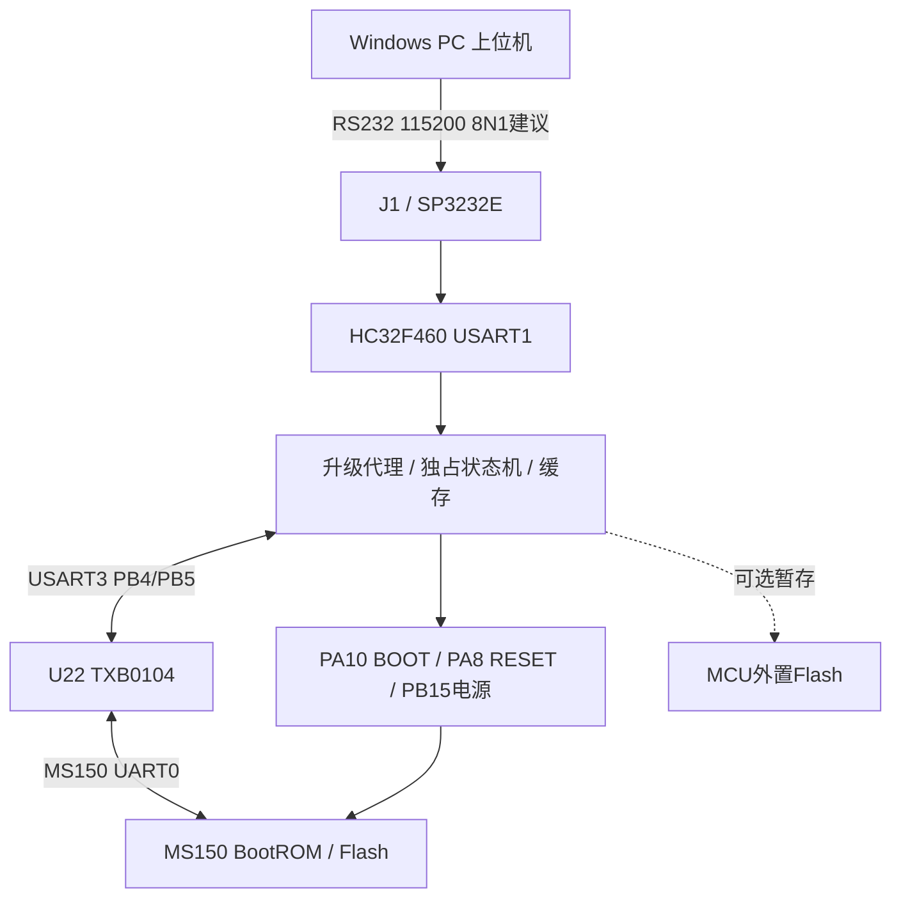

# NTN 串口升级需求评审与 MCDT 反汇编复核报告

| 项目 | 内容 |
|---|---|
| 项目 | 铱星 NTN 卫星物联网智能终端 |
| 员工 | 员工2 |
| 日期 | 2026-11-26（按任务最新补充日期） |
| 版本 | V1.0 |
| 阶段 | Step1：需求理解、协同评审、既有反汇编证据独立复核 |
| 状态 | 静态证据复核通过部分关键项；原始EXE独立反编译、真实UART抓包和实板验证未完成 |

## 1. 执行摘要

任务来源：[step1-issue.txt](../step1-issue.txt)，包括2026-11-26新增的Bus Hound抓包问题。目标为Windows PC经终端RS232、HC32F460主MCU控制MS150/ST1000模组UART0下载固件。不是主MCU自身升级，也不是卫星链路OTA。推荐优先使用现有硬件，暂不扩展BLE、Android和Web升级功能。

本轮实际读取主仓库、119条未截断的目录树、员工1/2目录/3的报告、厂家手册文字提取以及既有汇编指令文件，并独立复算协议校验和、镜像分块和边界。

**重大新增发现：两条解除写保护0x57的调用均传入接收模式7，现有接收分支映射显示模式7的成功条件为累计字节数>=2；模式8才检查首字节0x06。此前员工3报告将其描述为单字节ACK，且误称接收模式6，不能作为实现规范。厂家文档描述文本应答，真实返回完整格式必须抓包确认。**

硬件路径具备实现基础；尚无真实板级烧录证明。不能将静态证据等同于实际协议完成确认。

## 2. GitHub资料访问与版本基线

主仓库 stephenshizl/2026_ntn_work_1，master。任务Blob SHA 89239ab9f7e483677aed71c50f426109546fcf1b；初始目录树SHA 11c03e376f9af1d8ba246729b27438eb71c1afbf（树SHA而非commit SHA）。中文路径可访问。

| 资料 | 核查状态 |
|---|---|
| 原理图PDF、GPIO XLSX | 确认存在；引用既有报告，未重新解析原件；员工1称原始GPIO表读取失败并采用可读副本 |
| MS150下载流程Rev1.4、远程升级方案Rev1.0 | 实际读取员工1保存的文字提取 |
| MS150操作指导手册 | 文件存在，参考既有报告 |
| CA033、CA034、二级boot、NV XML、logmap | 目录、文件大小已核查；未独立重算原始二进制哈希 |
| MCDTV5.exe | 5,320,192 B，Git Blob SHA efa79268e2e4e31060440777fae7d785384cf03e |
| 既有分析与汇编 | 员工1/3核心报告、员工2目录员工5旧报告、汇编证据文件已读 |
| 实板、原厂运行日志、UART抓包 | 未取得 |

### 2.1 原始EXE访问限制（重要）

已尝试：
- GitHub fetch_file以base64读取原EXE：返回Blob SHA但content长度为0；
- GitHub fetch_blob：UnicodeDecodeError，无法按UTF-8解释PE；
- GitHub Git blob接口：拒绝非UTF-8响应；
- 本地运行环境直接curl raw.githubusercontent.com：DNS解析失败。
- 本地objdump/llvm-objdump存在，未找到已可用的Ghidra、Capstone、angr。

因此本次是**对已有反汇编文本的独立指令级复核及算法复算**，不是从原EXE重新生成汇编或Ghidra伪代码。不能声称已经独立反编译原EXE。原文件的既有SHA256记录为91ce79dbe330a024e317e915230cf146db6724b9eb8e56918094f9a820d4df64；来自员工1 mcdt_xrefs.json，本轮未重新计算。建议直接上传原始EXE到对话/分析环境，固定哈希后执行原始二进制复核。遵守供应商授权及许可，不运行不可信EXE于生产环境。

### 2.2 软件工程引用

| 工程 | 分支 | 主仓库Gitlink | 状态 |
|---|---|---|---|
| hc32f460_rtthread_ntn | work_v1_boot_fix | 03b0abc3f4062178c1d5864100bdc98e9c87b905 | GitHub仓库元数据可读；branches=[]，树接口409 Git Repository is empty |
| fw-AC63_BT_SDK | master | 9ffc3f744261d006535b7c962f80ff90e18c2ecd | 分支存在，SHA相符 |
| ntn_android_app | main | 4e9d99d055a2f9e17f23d7b946f538167df8753f | 分支存在，SHA相符 |
| ntn_web_app | boot_fix | 5dcf318da123d2f7dfd6005c98eff545f580fa57 | 分支存在，SHA相符 |

Gitlink不是完整源码。请在本地MCU工程执行git status、git branch -avv、git remote -v，确认正确remote后推送work_v1_boot_fix，再用git ls-remote --heads核对。历史代码问题需在指定commit重新核实。

## 3. 硬件架构及软件边界

依据三个员工历史报告：



| 功能 | MCU | 模组 |
|---|---|---|
| 下载TX | PB4 USART3 | UART0_RXD Pin32 |
| 下载RX | PB5 USART3 | UART0_TXD Pin33 |
| BOOT | PA10 | Q4反相，MCU高有效，模组BOOTSEL低有效 |
| RESET | PA8 | Q3反相，MCU高有效，模组RESETN低有效 |
| 电源 | PB15 | 极性、时序、实际控制逻辑待复核 |

MS150自身UART3不是下载UART0。PC侧RS232与板内UART独立设速。员工报告对SP3232E最大速率存在120kbps/235kbps等差异，必须以实物后缀及厂家规格为准，先按115200设计，不能直接把PC COM口切至1.5Mbps。板内1.5Mbps还需验证实际时钟、TXB0104电平、波形和UART DMA/ISR吞吐。

历史员工1指出ntn_ms150.c的接收线程同时处理AT/URC及回调，正常透传可能按行解析；hw_power_ntn_set(true)可能清除BOOT下载选择；DMA配置待核对。以上是历史代码证据，不冒充本轮源码复核。建议建立独占二进制会话，暂停AT/URC、定时发送、正常透传和自动复位，保留唯一UART读者，显式控制BOOT/RESET/电源；成功或失败均安全恢复业务。

## 4. 反汇编证据及方法

证据级别：
- A：本轮直接阅读既有汇编指令，结合调用关系和算术独立推导；仍未重新从原EXE验证指令真实性。
- B：厂家文字或员工报告支持，但本轮未完整复核对应路径。
- C：建议/推测，需实板、源码或厂家确认。
没有动态实测级证据。

| 证据文件（员工1/evidence） | Blob SHA |
|---|---|
| mcdt_endian_crc.txt | 99ca542fdb769d4a3a52222514e2c03f2affbfd6 |
| mcdt_receive.txt | 7dd5dfd7f4eb039cd4b16dbe499b46c0c7059800 |
| mcdt_io_helpers.txt | 18f18f95ca392681052c8f239e103b49717834f1 |
| mcdt_command_strings.txt | 89df7fd6dd2283be27203a905f421ef8ab023d95 |
| mcdt_xrefs.json | 7e480b1c913b19aa159a2dabfde40608b85e7960 |
| mcdt_flash_functions.txt | fdc53b66dcb1fd5025380cdd7658536e7ab359d0 |
| verification.json | f6e11a3cd3b26f7fc1524c2e4fa302be9b7b7379 |

另读 mcdt_disassembly.txt 中0x14013DFD0附近的解除写保护调用。全部地址是既有报告ImageBase=0x140000000下的VA，运行时ASLR应使用RVA。函数名称为功能性命名，非恢复的原始符号。

### 4.1 XOR、端序（A）

0x14013CE06置r9b=FF，0x14013CE21对每字节XOR，0x14013CE49追加r9b；公共发送0x14013D71F、0x14013D74D、0x14013D776也显示相同机制。CHK覆盖命令、地址、长度（若存在）和数据；字符串末尾内部NUL不是协议额外字节。整帧全部字节异或结果为FF。

0x140136B20依次写入最高24位、16位、8位和最低8位，BE32；0x140136850按[3]至[0]重建LE32，用于分区字段读取。协议地址与分区表数据端序不可混淆。

语义伪代码（人工还原，非反编译器原始输出）：

```c
uint8_t chk(const uint8_t *p, size_t n) {
    uint8_t c = 0xff;
    while (n--) c ^= *p++;
    return c;
}
void put_be32(uint8_t *p, uint32_t x) {
    p[0]=x>>24; p[1]=x>>16; p[2]=x>>8; p[3]=x;
}
uint32_t get_le32(const uint8_t *p) {
    return (uint32_t)p[0] | ((uint32_t)p[1]<<8) |
           ((uint32_t)p[2]<<16) | ((uint32_t)p[3]<<24);
}
```

### 4.2 公共发送/接收函数与超时（A）

0x14013D6D0：依据add_chk参数决定是否追加XOR；0x14013D7AA调用0x14013D990发送；失败转0x14013D91C。0x14013D7D2设置r9d=0xBB8(3000)，0x14013D7CE将调用者的接收模式作为第五参数，0x14013D7E3调用0x14013DA70。收成功后拷贝返回数据并返回true，失败返回false。

0x14013DA70：根据接收模式检查累计数据。0x14013DAAE—0x14013DAC6的整数运算符合timeout/100；0x14013DB52加0x5F5E100=100000000ns；因此存在约100ms轮询/等待设计。3000是该公共助手传入的超时参数，不保证UART线上严格3秒，也不能推广为所有擦写指令的超时值。失败路径0x14013DE81置FFFFFFFF。建议MCU使用单调时钟及绝对deadline，分别设握手、擦除、写入、读页超时；按实测确定，不盲目复制Windows轮询。

### 4.3 重要勘误：0x57解除写保护应答（A，动态待确认）

已复查汇编：
- 字符串VA 0x14034A5C8：575680001806000001；0x14034A5E0：575680002400000200。
- 0x14013E08F / 0x14013E16D 引用上述字符串。
- 0x14013E0CD / 0x14013E1AF 将add_chk置1。
- **0x14013E0D1 / 0x14013E1B3将接收模式明确置7**。
- 0x14013E126 / 0x14013E208 调用公共发送0x14013D6D0。
- mcdt_endian_crc.txt记录跳转表：mode6→0x14013DD68，mode7→0x14013DD40，mode8→0x14013DD36，mode9→0x14013DD75。
- 0x14013DD40：cmp ebx,2；jge 0x14013DDB5。即mode7累计长度至少2字节即满足此接收分支。
- 0x14013DD36：cmp byte ptr [rdi],6；je 0x14013DDB5。即mode8检测首字节0x06。
- 0x14013D7E8之后依据接收函数返回判断失败，成功复制内容。

独立复算TX：57 56 80 00 18 06 00 00 01 61；57 56 80 00 24 00 00 02 00 58。文档遗漏CHK的结论可信。但厂家手册称响应包含寄存器文本，现有反汇编只能支持mode7的接收门槛，**不能确定完整线上响应或宣称仅ACK**。此前员工3报告称mode6并等待单字节06，与上述证据冲突；应修订。需进一步从原EXE重新解码跳转表、检查上层对返回数据的额外判定、抓包验证。未确认前不写死只接收一个字节的实现。

### 4.4 0x7A变长写入（A）

0x14015D5E0初始头长5，0x14015D5EF默认操作码79；0x14015D727读取块长度，0x14015D72A与0x10000比较，0x14015D730长度>=64KiB跳过7A分支。小于64KiB时0x14015D732写7A，0x14015D73B/743/74B/751写入长度的四个BE字节至头偏移5/6/7/8，0x14015D754将头长置9。

| 类型 | 帧结构 | 整帧字节数 |
|---|---|---|
| 0x79 | OP(1)+ADDR_BE32(4)+DATA(65536)+CHK(1) | 65542 |
| 0x7A | OP(1)+ADDR_BE32(4)+LEN_BE32(4)+DATA(n)+CHK(1) | 10+n |

n建议1..65535，64KiB使用79，零长度无意义；地址256B对齐并落在已验证分区范围内。数据中00/0D/0A均按二进制传送，禁止字符串截断。0x14015D961发送头后，0x14015DB4A比较0x1C9C380，即30,000,000ns，jle继续等待；支持头与数据分开且至少30ms等待的实现。Windows串口写入返回不一定代表最后一位已出线；MCU建议等待UART TX完成再计30ms，具体容差抓包确认。后续0x200分段可见，但这是主机发送块粒度，不等于每512B必有协议ACK。

### 4.5 0xEB读页（A）

0x14015F9A2置EB，0x14015F9B2设本体长度5；0x14015F9E3设接收模式6；0x14015FA03调用公共发送。0x14013DD68比较累计字节数恰等于0x100，0x140166DEF设2次复制，0x140166E00—0x140166E50每轮128B，共256B。0x14是校验，不是长度。厂家文档20B解释错误。帧EB+ADDR_BE32+CHK，首地址向量EB 00 00 00 00 14。不要先丢弃假想ACK，否则可能错位；需抓包确认是否有额外状态字节和如何区分异步噪声。

### 4.6 其余协议与待确认事项

| 命令 | 意义 | 证据 |
|---|---|---|
| C0 3F | 停止连续U、查询版本 | B厂家文档 |
| 46 B9 | 初始化QSPI，文档ACK06 | B |
| 55 AA | 配置时钟，文档ACK06 | B |
| 50 09 A6 | 1.5Mbps | B，ACK旧/新速率及延迟需实测 |
| 20 ADDR CHK | 擦4KiB | B |
| D8 ADDR CHK | 擦64KiB | B |
| 79/7A | 写块 | A头部及间隔，响应需实测 |
| EB | 读256B页 | A |
| 32 | 写256B页（分区表） | B |
| 02 | NV写页（文档） | B，不默认执行 |
| 50 04 AB | 恢复115200 | B |
| B0 4F | 软件启动 | B；可优先硬件复位 |

本轮独立计算10条CHK向量全部与员工1离线结果相符：C03F、46B9、55AA、5009A6、5004AB、B04F、57568000180600000161、57568000240000020058、EB0000000014、2000000000DF。后者擦除首扇区，不能作为探测命令。完整13档波特率表、500ms切换、NV编译器、所有返回码、重试次数、MCDT特定型号路径尚未独立复核，不作为已定规范。

## 5. 固件与分区安全

| CA034 | 文件字节 | 默认起始 | 数据结束(不含) | 4KiB向上取整结束 | 块数/尾长 |
|---|---:|---|---|---|---|
| E31 | 2509271 | 0x28000 | 0x28C9D7 | 0x28D000 | 613块/2519B |
| DSP | 74519 | 0x3A8000 | 0x3BA317 | 0x3BB000 | 19块/791B |

本轮独立整数复算：E31按64KiB为38个完整块+18903B尾块，DSP为1个完整块+8983B尾块（注意这里只是按长度分块，不代表所有块地址满足64KiB擦除对齐）。总2,583,790B，115200/8N1纯发送下限224.287秒，1.5Mbps为17.225秒；4KiB分块632次，单算30ms间隔再增加18.96秒，不含擦除/读回/重启/PC暂存/流控。完整64KiB策略可减少间隔但需验证缓存和恢复。

员工1默认分区配置：二级boot 0x8000容量0x20000，E31容量0x380000，DSP容量0x60000，cfg_nv 0x4C4000，file_system 0x4D0000。不得硬编码为实板已确认地址。厂家结构fixed_inf按32位自然对齐推导88B，12个partition_t各12B，stamp及rsvd共24B，总256B；firmware.mv_length偏移0x78，dsp0_code.mv_length偏移0x84。应先识别实板结构及magic，验证读回、边界、保留字段，分区表首4KiB整体备份，最后更新并读回。sec_mv_length=0x2000为启动搬移参数，不可替换成二级boot文件大小。首版仅升级配套E31/DSP，默认保留boot/NV及文件系统，待厂家验证版本兼容。

员工1称两版boot/NV哈希相同，DSP大小相同但内容不同；本轮仅复算尺寸和边界，未独立读取原BIN验证哈希。员工3NV脚本生成422B，但不等于实际原厂每页序列化、主备区布局、PageCRC均正确。厂家主区0x4C4000、备份0x4C6000与工具全局0x56F000不同，后者落在默认file_system范围，必须追踪实际型号路径。禁止未经验证的NV写入。厂家声称回滚，但无实板布局证明；没有验证A/B就不能承诺自动回滚或掉电原子性。

## 6. 员工协同评审与实施方案

员工1支持4KiB分块代理，员工2目录员工5旧报告支持PC引擎+MCU代理，员工3推荐整包暂存及透明模式。本报告保留旧文件，不改变原作者署名。建议研发优先PC直接连接可恢复厂家测试板建立只读POC并完成真实原厂抓包；再做MCU有限缓存代理。量产评估外置Flash完整暂存方案，验证实际FAL分区、容量、擦写寿命和持久化恢复记录。整包暂存使得擦写前完成包校验及PC掉线后有机会继续，但不能据此宣称双备份可用。

PC负责文件选择、manifest、版本及目标设备检查、帧序号/CRC32、日志与进度；MCU负责BOOT/RESET、独占UART、接收完整数据块后再发送模组指令、地址白名单、读回、失败状态和退出恢复。PC-MCU CRC32独立于模组XOR。建议PC代理帧包含版本、会话ID、命令、序号、长度、载荷、CRC32；具体字节格式在Step3定稿，不假定已有协议。

状态机：IDLE→PRECHECK→ENTER_BOOT→SYNC→INIT→READ_TABLE→PLAN→ERASE→WRITE→VERIFY→COMMIT_TABLE→REBOOT→CHECK_VERSION→DONE；任一错误进入ERROR/RECOVERY。读取/查询可有限重试；擦写超时先查状态或读回，不盲目重复非幂等命令。先确认整个包/目标/安全边界，失败后禁止继续擦写其他分区。只有实际读回和版本校验通过才能报告成功。

## 7. Bus Hound + 逻辑分析仪方案

Bus Hound可尝试监控Windows串口/USB-UART I/O，官网https://perisoft.net/bushound/；当前适配器驱动能否提供完整数据及控制事件需现场测试，注意捕获长度、缓冲容量及版本限制。软件时间戳不是实际UART线上的帧间隔；USB包边界不等于UART协议帧；必要时去除USB-UART厂商状态字节。逻辑分析仪建议24MHz或更高，输入阈值匹配IO电压，共地，高阻并联采集TX/RX、BOOTSEL、RESETN，禁止TTL探头直接接RS232高电压侧。不要让两个驱动同时驱动同一TX线。

现场步骤：
1. 固定MCDT版本、COM号、适配器型号、下载选项及镜像哈希；准备有恢复能力的测试板、已知正常固件，备份分区和NV。
2. 选择Bus Hound对应COM/USB设备，开启双向数据、控制事件和时间戳，验证无截断；先抓握手和只读查询。
3. 并行采集UART波形，按115200和1.5Mbps分别解码；记录BOOT、RESET、速率变更点。
4. 测试板用原厂工具执行CA033→CA034，选择配套E31/DSP，不无意擦写boot/NV；保存完整原始记录及升级前后ATI/AT+CGMR。
5. 将TX/RX按命令头、长度、校验、应答重组，复算CHK并与厂家和静态证据比对。
6. 首轮仅采集合法原厂流程，后续在具备恢复条件的板上验证超时、断开、重复升级、掉电恢复、校验及入网数据收发。

| 验证编号 | 具体验收 |
|---|---|
| CAP01 | 连续U、C0停止、版本返回 |
| CAP02 | 0x57两个10B TX，RX全部字节、文本/ACK/NACK实际顺序 |
| CAP03 | 0x50速率切换命令、ACK速率、主机改速时刻 |
| CAP04 | 0xEB首地址返回长度、数据头尾、读页重复性 |
| CAP05 | 0x79/7A头、真实LEN、30ms线间隔、尾CHK、512B分段和最终应答 |
| CAP06 | 擦除粒度、写入/读回时序、分区表更新前后差异 |
| CAP07 | 正常复位、ATI/CGMR、新版本注册和数据收发 |
| CAP08 | NV/boot专项需额外授权及可恢复测试板，非本轮默认项 |

产出建议：manifest.json、raw_capture、logic_capture、decoded_frames.csv（时间、方向、速率、原始HEX、命令、地址、长度、校验、应答、证据编号）、protocol_spec.md、validation.md。未取得真实捕获之前不能填写实测结果。

## 8. 后续独立原EXE反编译计划与验收

取得原EXE后先重新计算SHA256，与记录比对；解析PE架构、区段、导入、异常函数表、字符串交叉引用；使用objdump/llvm-objdump重新生成汇编，可在具备Ghidra/IDA的受控环境导出伪代码。重新定位公共发送/接收、跳转表、串口初始化及SetCommState、0x57路径、0x79/7A、EB读页、擦除策略、NV PageCRC、旧/新分区表和多合一解析器。确认函数真实调用、所有参数、错误分支与型号选择；将分析脚本、VA/RVA、哈希、伪代码和测试向量保存到员工2目录。不能用人工伪代码冒充原始源码；静态确认仍需真实UART抓包收口。

## 9. 工作安排及项目门槛

| 阶段 | 内容 | 验收 |
|---|---|---|
| Step1 | 本报告、资料可达性、既有汇编勘误 | 已完成本轮范围 |
| Step2 | 原EXE独立反编译+双向抓包 | 原文件哈希、完整记录、争议关闭 |
| Step3 | 统一协议规范和MCU源码审核 | 指定分支可读、唯一规范、测试向量 |
| Step4 | Python直接UART POC | 可恢复测试板读写校验通过 |
| Step5 | MCU升级代理和PC POC | PC→MCU→NTN成功 |
| Step6 | 正常业务与异常恢复测试 | 重复升级、断电、掉线、失败可恢复 |
| Step7 | 正式上位机及交付 | 版本、操作SOP、工厂验收 |

优先协调：原始EXE可下载附件、MCU分支推送、厂家开发板及可恢复镜像、USB-UART及逻辑分析仪、完整抓包、SP3232E实物后缀、厂家确认0x57应答及NV/回滚。未经实板证据禁止定稿或量产。

## 10. 来源及交付边界

- [任务](../step1-issue.txt)
- [员工1交付索引](../员工1/README_员工1.md)
- [员工1协议核对](../员工1/协议核对与参考工具分析_员工1.md)
- [员工1硬件工作报告](../员工1/NTN串口升级可行性与工作报告_员工1.md)
- [员工1汇编证据](../员工1/evidence/)
- [员工3交付索引](../员工3/README_员工3.md)
- [员工3协议分析](../员工3/MS150升级协议反汇编全量解析与勘误规范_员工3.md)
- [员工2目录既有员工5报告](员工5_20261111_NTN固件上位机串口升级分析与实现方案.md)

本报告只新增员工2目录的Markdown，不修改任何生产代码、厂家协议、固件或其他员工报告，不执行硬件擦写。不把接口push权限当作原始二进制下载能力。主仓库公开，供应商原理图、协议和固件如涉及保密应由负责人审核并考虑设为Private。本文所有设计选择均为建议，需项目经理与现场验证批准。
