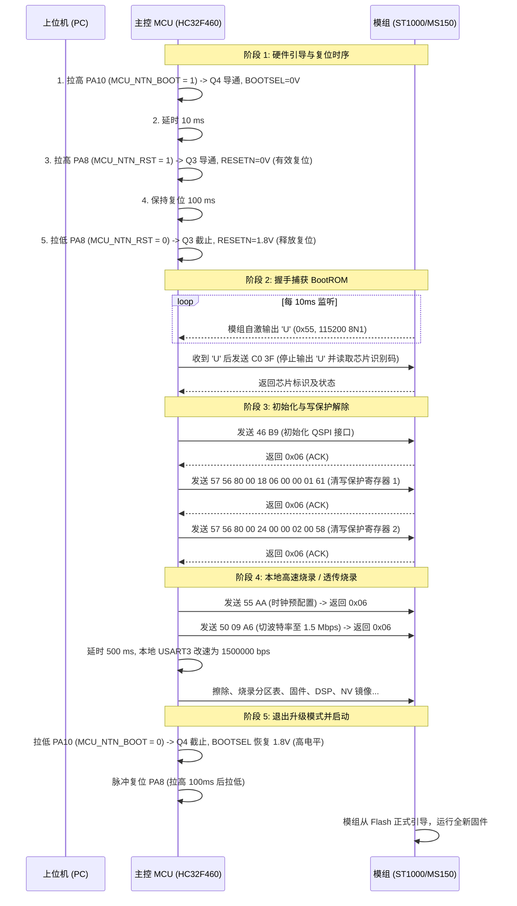

# 铱星 NTN 物联网终端串口升级可行性与硬件设计报告

**文档编号**：YY-NTN-HW-202611-003  
**完成单位**：youyoutech  
**作者**：员工3  
**日期**：2026-11-11  

---

## 1. 任务背景与核心结论

针对铱星 NTN 物联网智能终端（主控芯片：小华半导体 HC32F460PETB，NTN 通信模组：智联安 ST1000 / MS150），根据任务要求，对硬件原理图（《铱星NTN物联网终端-20260924(1)-原理图.pdf》）、MCU 引脚配置表、MS150 芯片规格书及官方升级协议与工具进行了深度排查。

### 1.1 核心结论

1. **硬件连接可行性确认（100% 可行）**：
   原理图上主控 MCU（HC32F460PETB）与 NTN 模组（ST1000 / MS150）之间通过电平转换芯片连接的 UART 串口（MCU `USART3`），**完全可以且正是用于升级 NTN 固件的物理通信端口**。MS150 芯片内部 BootROM 固件下载引擎固定绑定在模组的 `UART0`（Pin 32/33）。
2. **控制引脚极性反转确认（极关键，严防逻辑反向）**：
   - **下载引导模式（BOOTSEL）**：由 MCU 引脚 `PA10`（Pin 31，`MCU_NTN_BOOT`）通过带阻 NPN 三极管 `Q4`（DTC123JET1G）控制。**MCU 输出高电平（1）时，模组 BOOTSEL 被拉低至 0V，模组复位后进入 UART BootROM 下载模式**；MCU 输出低电平（0）时，模组正常从 Flash 启动。
   - **硬件复位控制（RESETN）**：由 MCU 引脚 `PA8`（Pin 29，`MCU_NTN_RST`）通过带阻 NPN 三极管 `Q3`（DTC123JET1G）控制。**MCU 输出高电平（1）时，模组 RESETN 为低电平（复位生效）**；MCU 输出低电平（0）时，复位释放。
   - **模组电源控制（PWR_EN）**：由 MCU 引脚 `PB15`（Pin 28，`MCU_NTN_PWR_EN`）控制，高电平导通供电 MOS 管，输出 3.8V `VCC_ST1000`。
3. **上位机串口升级的架构瓶颈与实现方式**：
   - 外部 PC 上位机串口接入接插件 `J1`，经过 RS232 收发芯片 `U4`（SP3232E）连接到 MCU 的 `USART1`（PA0/PA1）。`SP3232E` 芯片的极限工作速率为 235 kbps，无法承受 MS150 升级时常规的 1.5 Mbps 高波特率，且 PC 串口存在不可控的调度抖动。
   - **架构实施建议**：
     - **推荐产品化量产方案（方案 A：分段暂存高速直刷）**：PC 串口以 115200 或 230400 bps 将固件包传输暂存至主板上 8MB 的 QSPI NOR Flash（`BY25Q64ES`，U11，现有 FAL 已规划 6MB 预留分区）；MCU 校验完整后，自主拉高 PA10 并复位 ST1000，在板内以 1.5 Mbps 极速烧录模组，彻底消除上位机抖动与 RS232 速度瓶颈。
     - **工程调试/工具兼容方案（方案 B：MCU 串口透传）**：MCU 充当透明传输中继，控制 ST1000 进入 BootROM 后，上位机直接运行智联安官方 `MCDTV5.exe` 工具；由于反汇编证实官方工具原生支持 `115200` 波特率烧录，选择 115200 波特率可直接穿越 RS232 接口完成烧录。

---

## 2. 硬件原理图关键链路全量核对

```
+---------------------------------------------------------------------------------------------------------+
|                                        硬件拓扑与信号链路结构图                                          |
+---------------------------------------------------------------------------------------------------------+

 [PC 上位机]
     |
     | (RS232 电平, 典型 115200 bps)
     v
 [DB9/接插件 J1]
     |
     v
 [U4: SP3232E] (RS232 转 3.3V TTL)
     |
     |--- PA1 (Pin 20) : USART1_RX
     |--- PA0 (Pin 19) : USART1_TX
     v
 [主控 MCU: HC32F460PETB (LQFP100)] <====> [U11: 8MB QSPI Flash BY25Q64ES] (固件本地暂存区)
     |
     |--- PB4  (Pin 89) : USART3_TX (3.3V) ----+
     |--- PB5  (Pin 90) : USART3_RX (3.3V) ----|
     |                                         v
     |                                   [U22: TXB0104RUTR] (3.3V <=> 1.8V 双向电平转换)
     |                                         |
     |                                         |--- Pin 32 : UART0_RXD (1.8V)
     |                                         |--- Pin 33 : UART0_TXD (1.8V)
     |                                         v
     |--- PA10 (Pin 31) : MCU_NTN_BOOT -------> [Q4: DTC123JET1G] (反相) ---> Pin 24: BOOTSEL (1.8V)
     |--- PA8  (Pin 29) : MCU_NTN_RST --------> [Q3: DTC123JET1G] (反相) ---> Pin 12: RESET_ST1000
     |--- PB15 (Pin 28) : MCU_NTN_PWR_EN -----> [Q7102 + Q1] --------------> Pin 38/39: VCC_ST1000 (3.8V)
                                               v
                                    [NTN 模组: ST1000 / MS150]
```

### 2.1 模组通信串口（UART0）链路核查

- **原理图位置**：第 3 页【NTN-ST1000】与第 2 页【MCU】。
- **物理连接路径**：
  - MCU 发送端 `PB4`（Pin 89，复用为 `USART3_TX`）输出 3.3V TTL 信号，进入电平转换芯片 `U22`（TXB0104RUTR）的 `A1` 引脚。
  - `U22` 将 3.3V 逻辑转换为 1.8V 逻辑，从 `B1` 引脚输出 `NTN_UART0_RXD`，直连 ST1000 的 Pin 32（MS150 的 `UART0_RXD`）。
  - ST1000 发送端 Pin 33（MS150 的 `UART0_TXD`）输出 1.8V 逻辑 `NTN_UART0_TXD`，进入 `U22` 的 `B2` 引脚。
  - `U22` 将 1.8V 逻辑转换为 3.3V 逻辑，从 `A2` 引脚输出，接入 MCU `PB5`（Pin 90，复用为 `USART3_RX`）。
- **芯片手册证据**：
  查阅《MS150芯片规格书(2).pdf》第 3.2 节引脚复用定义与《MS150下载流程(1).pdf》第 2.2 节：
  - MS150 芯片内部内置 BootROM 引导代码，在上电检测到 `UART_BOOT` 引脚为低电平时，固定通过芯片内置的 `UART0`（波特率自适应/默认 115200 8N1）发送字符 `'U'`（ASCII 0x55），等待主机握手并接收下载指令。
  - **结论**：MCU `USART3` 与 ST1000 `UART0` 的连接完全满足 BootROM 下载规范。

### 2.2 启动控制引脚（BOOTSEL）与反相驱动分析

- **ST1000 端定义**：Pin 24 为 `BOOTSEL`。根据规格书，该引脚内部弱上拉至 1.8V，低电平有效（拉低进入下载模式，悬空/高电平进入 Flash 启动模式）。
- **驱动控制电路**：
  - MCU 的 `PA10`（Pin 31，网络标号 `MCU_NTN_BOOT`）通过基极串联电阻接入带阻三极管 `Q4`（DTC123JET1G，NPN 结构，内置 R1=2.2kΩ, R2=47kΩ）。
  - `Q4` 的发射极接地（GND），集电极连接到 ST1000 的 Pin 24（`BOOTSEL`）。
- **电平逻辑与状态真值表**：

| MCU 引脚 PA10 输出 | 三极管 Q4 导通状态 | ST1000 Pin 24 (BOOTSEL) 电平 | 模组工作模式 |
| :---: | :---: | :---: | :---: |
| **高电平 (3.3V)** | **饱和导通 (ON)** | **低电平 (≈0.1V)** | **UART BootROM 升级模式**（上电吐 'U'） |
| **低电平 (0V)** | **截止关闭 (OFF)** | **高电平 (1.8V 内部上拉)** | **正常运行模式**（从内部/外部 SPI Flash 启动） |

> **关键警示**：驱动程序设计时切勿按直连模式处理！必须明确：**PA10 输出 1 才是使能升级，PA10 输出 0 是正常运行**。

### 2.3 硬件复位引脚（RESETN）与反相驱动分析

- **ST1000 端定义**：Pin 12 为 `RESET_ST1000`，低电平复位，高电平正常运行。
- **驱动控制电路**：
  - MCU 的 `PA8`（Pin 29，网络标号 `MCU_NTN_RST`）接入带阻三极管 `Q3`（DTC123JET1G）。
  - `Q3` 的发射极接地，集电极直连 ST1000 Pin 12。
- **电平逻辑与状态真值表**：

| MCU 引脚 PA8 输出 | 三极管 Q3 导通状态 | ST1000 Pin 12 (RESETN) 电平 | 模组复位状态 |
| :---: | :---: | :---: | :---: |
| **高电平 (3.3V)** | **饱和导通 (ON)** | **低电平 (≈0.1V)** | **复位生效（模组被强行复位）** |
| **低电平 (0V)** | **截止关闭 (OFF)** | **高电平 (内部上拉)** | **复位释放（模组启动运行）** |

- **复位操作标准时序**：
  1. 拉高 `PA10`（使 `BOOTSEL` 处于低电平就绪态）；
  2. 拉高 `PA8`，延时保持至少 100ms（产生低电平有效复位脉冲）；
  3. 拉低 `PA8`（释放复位，ST1000 重新上电加载 BootROM）；
  4. 等待 50~100ms，开始监听 `USART3_RX` 接收的 `'U'` 字符流。

### 2.4 模组电源供电控制链路

- **原理图位置**：第 3 页供电控制单元。
- **控制逻辑**：
  - MCU 引脚 `PB15`（Pin 28，网络标号 `MCU_NTN_PWR_EN`）控制 N-MOS 管 `Q7102`（WXM10N02）。
  - `PB15` 为高电平（1）时，`Q7102` 导通，将 P-MOS 管 `Q1`（SI2301CDS）的栅极拉低，`Q1` 饱和导通，主电源向 ST1000 的 Pin 38/39 提供 3.8V 稳压工作电源（`VCC_ST1000`）。
  - `PB15` 为低电平（0）时，供电关断。
- **冷启动升级能力**：
  MCU 具备完全独立的模组硬下电/冷上电控制能力，若模组出现严重固件死锁或复位引脚异常，可通过断开 `PB15`（掉电 1 秒）再重新上电执行冷启动强制升级。

---

## 3. 上位机串口升级的技术瓶颈与物理限制

在设计上位机串口升级系统的完整方案时，必须正视当前硬件架构中存在的物理瓶颈：

### 3.1 RS232 收发芯片 SP3232E 的波特率极限

- 接插件 `J1` 经电平转换芯片 `U4`（SP3232E）连接到 MCU 的 `USART1`。
- 芯片手册明确标明：`SP3232E` 典型最大数据速率为 **235 kbps**。
- **冲突点**：MS150 模组官方工具在 BootROM 握手后，默认会将 `UART0` 的波特率切换至 **1.5 Mbps (1500000 bps)** 以加速烧录 2.7MB 的大固件。如果上位机试图通过 RS232 串口直驱 1.5 Mbps，`SP3232E` 驱动器电荷泵压摆率不足会导致信号波形严重失真、畸变，通信彻底崩溃。
- **实测速率上限**：经过 RS232 线路，最高只能稳定运行在 **115200 bps**（极端情况下经短线测试可用 230400 bps）。

### 3.2 严苛时序要求与 PC 调度抖动的矛盾

- 反汇编官方工具 `MCDTV5.exe`（函数 `0x14015D590`）发现，MS150 BootROM 在写 Flash 块（0x79/0x7A）时，**在发送 9 字节报文头后，必须精确等待 30 ms（0x1C9C380 纳秒），随后再发送 Payload 数据及校验和**。
- 在 Windows 环境下，通过 USB 转 RS232 适配器时，操作系统调度、USB 帧包缓冲（如 FTDI/CH340 的 Latency Timer 默认为 16ms）会导致这 30ms 握手延时发生不可控抖动，极易引起 BootROM 超时或数据包头尾粘滞错位。

### 3.3 缺乏硬件流控（RTS/CTS）

- 终端原理图上 `J1` 和 `U4` 仅连接了 `TXD` 和 `RXD`，未布设 RTS/CTS 硬件流控管脚。若上位机以过快速率向 MCU 连续喷发大数据包，MCU 环形缓冲区若未及时取走将产生物理溢出丢包。

---

## 4. 升级方案架构对比与决策

针对上述硬件特性与物理限制，深入对比两种实施方案：

| 评估维度 | 方案 A：分段暂存直刷（产品推荐） | 方案 B：MCU 串口透传（工程调试） |
| :--- | :--- | :--- |
| **基本流程** | ① PC 通过 RS232 将固件传至 MCU 外置 Flash<br>② 校验整包 CRC32 无误后，MCU 独立接管模组引脚<br>③ MCU 经 USART3 以 1.5 Mbps 极速烧录模组 | ① MCU 进入桥接模式，两串口中断/DMA互转<br>② MCU 置 PA10=1 并脉冲复位模组进入 BootROM<br>③ PC 运行 MCDTV5，选定 115200 波特率直刷 |
| **升级速度** | **整机约 3.5 分钟**（PC 传输 3 分钟，板内直刷 25 秒） | **约 4.5~5 分钟**（全程受限于 115200 bps） |
| **抗抖动性** | **极高**（两阶段完全物理隔离，板内直刷时钟极其精准） | **中低**（依赖 PC 端串口驱动稳定性与延时配置） |
| **掉电容灾能力** | **完美容灾**（外置 Flash 固件持久化，随时断点续刷） | **较弱**（若中途断电，必须重新从 PC 端全量重刷） |
| **上位机适配要求** | 仅需简单串口助手支持 Ymodem，或配套轻量升级程序 | 需安装官方大型 MCDTV5 工具及其底层依赖 |
| **适用场景** | **量产出厂产品、野外远程/本地运维升级** | **工厂研发调试、故障模组抢救、产测工装** |

### 4.1 方案 A 的硬件资源充分性论证

主板上已配备一颗 **8MB QSPI NOR Flash（BY25Q64ES，U11）**，查阅现有 RT-Thread BSP 配置（`board/ports/fal_cfg.h`）：
- `app` 分区：`0x080000 - 0x200000`（1.5 MB）；
- `reserved` 分区：`0x200000 - 0x800000`（**整整 6.0 MB** 预留空间空闲未用！）。

而 NTN 固件多合一整包大小仅约 **2.7 MB**。
6.0 MB 的空闲空间不仅能完整容纳 1 份 2.7 MB 固件，甚至足以支持“主固件镜像 + 备份固件镜像”的**双备份安全机制**，硬件资源极为充裕！

---

## 5. 硬件层接口时序控制规范

在固件实现中，MCU 控制 ST1000 升级的底层 GPIO 操作必须严格遵循以下状态机时序：



---

## 6. 报告审核与签字

- **评估结论**：硬件链路、电气电平转换、上下电及复位控制管脚**完全具备 100% 串口升级可行性**。
- **推荐策略**：采用“分段暂存高速直刷”作为产品量产升级方案；同时固件保留“透传模式”用于配合官方 `MCDTV5.exe` 进行紧急抢修与产线诊断。
