# 铱星 NTN 物联网终端串口升级实施方案与软件架构设计

**文档编号**：YY-NTN-ARCH-202611-003  
**完成单位**：youyoutech  
**作者**：员工3  
**日期**：2026-11-11  

---

## 1. 方案总体架构与场景分工

为兼顾产品量产的高可靠性、野外远程/本地运维的抗抖动能力，以及工厂研发阶段对智联安官方工具链的兼容性，本实施方案设计为**“一套核心体系，两种执行路径”**：

```
+-------------------------------------------------------------------------------------------------------------+
|                                     NTN 串口升级总体软件架构全景图                                           |
+-------------------------------------------------------------------------------------------------------------+

   +--------------------------+                                 +--------------------------------+
   |  PC 简易升级工具 / 串口助手 |                                 |  智联安官方工具: MCDTV5.exe     |
   +--------------------------+                                 +--------------------------------+
                |                                                                |
                | (Ymodem-1K / 自定义 CRC32 协议)                                 | (原生 MS150 BootROM 协议)
                | (RS232 @ 115200 / 230400 bps)                                 | (波特率固定选 115200 bps)
                v                                                                v
   +---------------------------------------------------------------------------------------------+
   | 终端主板接插件 J1  <===>  U4: SP3232E RS232 收发芯片  <===>  MCU USART1 (PA0/PA1)           |
   +---------------------------------------------------------------------------------------------+
                                                |
            +-----------------------------------+-----------------------------------+
            |                                                                       |
            v [方案 A: 分段暂存高速直刷 - 推荐量产方案]                               v [方案 B: 串口透明传输 - 研发/产测方案]
   +---------------------------------------------+                         +-----------------------------------+
   |  MCU 固件接收与校验引擎 (pc_rs232 / ymodem)    |                         |  MCU 双串口 DMA 零拷贝透明传输引擎  |
   +---------------------------------------------+                         +-----------------------------------+
            |                                                                       |
            v                                                                       |
   +---------------------------------------------+                                  |
   |  U11: 8MB QSPI Flash (BY25Q64ES)            |                                  |
   |  FAL 分区: ntn_fw (0x200000, 配额 6.0 MB)   |                                  |
   +---------------------------------------------+                                  |
            |                                                                       |
            v                                                                       |
   +---------------------------------------------+                                  |
   |  MCU 本地 NTN 烧录引擎 (ntn_burn_engine)      |                                  |
   |  - 状态机控制 GPIO (PA10=1, PA8 脉冲复位)      |                                  |
   |  - 极速通信: USART3 @ 1.5 Mbps (1500000 bps)|                                  |
   |  - 精确 30ms 握手、4KB/64KB 混合擦除/写入     |                                  |
   +---------------------------------------------+                                  |
            |                                                                       |
            +-----------------------------------+-----------------------------------+
                                                |
                                                v
   +---------------------------------------------------------------------------------------------+
   |  U22: TXB0104RUTR (3.3V <=> 1.8V 电平转换)  <===>  ST1000 / MS150 UART0 (Pin 32/33)         |
   |  控制管脚: PA10 -> Q4 -> BOOTSEL (Pin 24)  |  PA8 -> Q3 -> RESETN (Pin 12)                 |
   +---------------------------------------------------------------------------------------------+
```

### 1.1 场景与路径分工原则

1. **方案 A（分段暂存高速直刷）—— 产品级量产与现场运维核心方案**：
   - 彻底将“低速且不可靠的外部通信”与“高速且高敏感的板内芯片烧录”解耦。
   - 上位机将固件包传输暂存到主板自带的 8MB QSPI Flash 中，校验 CRC32 成功后，由 MCU 在板内以 1.5 Mbps 高速精准闭环烧录 ST1000。
   - **优势**：时序精度达微秒级、抗外部线缆插拔抖动、支持掉电断点安全续刷。
2. **方案 B（MCU 串口透传）—— 产线工装、研发调试与紧急救砖方案**：
   - MCU 仅作为双向透明中继，负责控制模组进入 BootROM，上位机直接运行官方 `MCDTV5.exe`。
   - **关键技术要求**：利用反汇编查明的波特率表，官方工具界面**必须选择 115200 波特率**，确保数据不突破 `SP3232E` 的 235 kbps 硬件极限。

---

## 2. 方案 A：分段暂存高速直刷方案详细设计

### 2.1 外部 Flash 存储规划（基于现有 FAL 框架）

查阅现存 RT-Thread BSP 配置 `board/ports/fal_cfg.h`，板载 8MB QSPI NOR Flash（`BY25Q64ES`）空间极其充裕。在 FAL 表中将原 6MB 的 `reserved` 细化为 `ntn_fw` 固件暂存区：

| 分区标号 | 起始物理地址 | 分区大小 | 用途说明 |
| :--- | :---: | :---: | :--- |
| `app` | `0x00080000` | 1.5 MB | MCU 自身固件存储区 |
| `ntn_meta` | `0x00200000` | 4 KB | NTN 固件元数据头（版本、文件大小、整包 CRC32、烧录状态标志） |
| `ntn_fw_main` | `0x00201000` | 2.8 MB | NTN 固件镜像主暂存区（容纳约 2.7MB 多合一镜像） |
| `ntn_fw_bak` | `0x004D0000` | 2.8 MB | NTN 固件镜像备份区（用于版本回滚与双备份容灾） |
| `reserved` | `0x007A0000` | 384 KB | 系统保留空间 |

#### 元数据结构体定义（4KB 头部）
```c
#pragma pack(push, 1)
typedef struct {
    uint32_t magic;          // 固件包魔数: 0x59595443 ("YYTC")
    uint32_t version;        // 固件版本号 (如 0x00050022 -> R005_CA034)
    uint32_t total_size;     // 固件镜像总字节大小
    uint32_t image_crc32;    // 固件镜像整包 CRC32 校验码
    uint32_t sec_boot_size;  // 二级 Bootloader 大小
    uint32_t fw_e31_size;    // 主固件 E31 大小
    uint32_t dsp_size;       // DSP 固件大小
    uint32_t nv_size;        // NV 参数镜像大小
    uint32_t burn_status;    // 状态: 0=未烧录, 1=正在烧录, 2=烧录成功, 0xFF=损坏
    uint8_t  reserved[4060]; // 填充至 4096 字节
} T_NTN_Firmware_Meta;
#pragma pack(pop)
```

---

### 2.2 阶段一：PC 到 MCU 传输协议实现（Ymodem-1K）

- **通信参数**：`USART1`，波特率配置为 115200 bps（短线测试可提升至 230400 bps），8 数据位，1 停止位，无校验（8N1）。
- **流程规范**：
  1. 上位机发送控制台命令 `ntn_update_start`；
  2. MCU 创建专用线程挂起常规业务，向 PC 循环发送字符 `'C'`（ASCII 0x43），发起 Ymodem-1K 握手；
  3. PC 端使用标准 Ymodem 协议下发固件文件，每包 1024 字节（带 16 位 CRC 校验）；
  4. MCU 边接收边写入 QSPI Flash `ntn_fw_main` 分区，并实时累计全量 CRC32；
  5. 传输结束，PC 发送 EOT 与空包结束符；MCU 比对元数据中预存的 CRC32。若匹配，置 `burn_status = 1`，向 PC 输出 `[SUCCESS] Firmware download completed, start burning NTN...`。

---

### 2.3 阶段二：MCU 本地驱动 NTN 极速烧录引擎

#### 2.3.1 USART3 硬件波特率精度计算
- 小华 HC32F460 PETB 的系统时钟配置为 200 MHz，外设时钟 `PCLK1 = 100 MHz`。
- `USART3` 配置为 8 倍过采样模式（`OVER8 = 1`），波特率寄存器计算公式：
  $$\text{DIV} = \frac{\text{PCLK1}}{8 \times \text{Baudrate}} = \frac{100,000,000}{8 \times 1,500,000} = 8.3333$$
- 开启小数分频（Fractional Baudrate），波特率误差仅为 **0.16%**，完全在异步串行通信允许的 $\pm 2.5\%$ 安全门限内，通信波形极其规整。

#### 2.3.2 烧录状态机详细设计

MCU 烧录引擎采用非阻塞状态机架构（基于 RT-Thread 独立高优先级线程实现）：

```mermaid
stateDiagram-v2
    [*] --> STATE_INIT
    STATE_INIT --> STATE_ENTER_BOOT: 校验 Flash 元数据有效
    
    state STATE_ENTER_BOOT {
        [*] --> DRIVE_PINS
        DRIVE_PINS: PA10 输出高 (BOOTSEL拉低)
        DRIVE_PINS --> PULSE_RST: 延时 10ms
        PULSE_RST: PA8 输出高 (RESET有效 100ms)
        PULSE_RST --> RELEASE_RST: PA8 输出低 (释放复位)
    }
    
    STATE_ENTER_BOOT --> STATE_CAPTURE_U: 监听 USART3
    
    state STATE_CAPTURE_U {
        [*] --> WAIT_U
        WAIT_U: 等待模组自激输出 'U' (0x55)
        WAIT_U --> SEND_C0: 收到连续 'U'
        SEND_C0: 发送 C0 3F (终止吐U并查询)
    }
    
    STATE_CAPTURE_U --> STATE_UNLOCK: 握手成功
    
    state STATE_UNLOCK {
        [*] --> INIT_QSPI
        INIT_QSPI: 发送 46 B9 (初始化 Flash) -> 期望 0x06
        INIT_QSPI --> CLEAR_WP1: 成功
        CLEAR_WP1: 发送 57 56 80 00 18 06 00 00 01 61 -> 期望 0x06
        CLEAR_WP1 --> CLEAR_WP2: 成功
        CLEAR_WP2: 发送 57 56 80 00 24 00 00 02 00 58 -> 期望 0x06
    }
    
    STATE_UNLOCK --> STATE_SPEED_UP: 解锁成功
    
    state STATE_SPEED_UP {
        [*] --> SEND_55AA
        SEND_55AA: 发送 55 AA (时钟预置) -> 期望 0x06
        SEND_55AA --> SEND_5009
        SEND_5009: 发送 50 09 A6 (申请 1.5M) -> 期望 0x06
        SEND_5009 --> DELAY_SWITCH
        DELAY_SWITCH: 阻塞延时 500ms -> USART3 重构为 1500000 bps
    }
    
    STATE_SPEED_UP --> STATE_BURN_IMAGES: 速率切换完成
    
    state STATE_BURN_IMAGES {
        [*] --> BURN_SEC_BOOT
        BURN_SEC_BOOT: 擦除并烧录二级 Boot (0x1000)
        BURN_SEC_BOOT --> BURN_E31: 成功
        BURN_E31: 擦除并烧录主固件 E31 (0x24000)
        BURN_E31 --> BURN_DSP: 成功
        BURN_DSP: 擦除并烧录 DSP 镜像 (0x2D4000)
        BURN_DSP --> BURN_NV: 成功
        BURN_NV: 擦除并写入 NV 双分区 (0x4C4000, 0x4C6000)
    }
    
    STATE_BURN_IMAGES --> STATE_SEAL_HEADER: 镜像写入完毕
    
    state STATE_SEAL_HEADER {
        [*] --> MAKE_HEADER
        MAKE_HEADER: 根据真实镜像大小填充 T_Header_5gNew
        MAKE_HEADER --> ERASE_SEC0: 擦除 0x000000 (首扇区 4KB)
        ERASE_SEC0 --> WRITE_PAGE0: 发送 0x32 写入 256B 分区表
    }
    
    STATE_SEAL_HEADER --> STATE_REBOOT_NORMAL: 分区表写入成功
    
    state STATE_REBOOT_NORMAL {
        [*] --> RESTORE_PINS
        RESTORE_PINS: PA10 输出低 (释放 BOOTSEL)
        RESTORE_PINS --> PULSE_RST_NORMAL
        PULSE_RST_NORMAL: PA8 脉冲复位 (拉高 100ms 拉低)
    }
    
    STATE_REBOOT_NORMAL --> [*]: 升级圆满完成
```



---

## 3. 方案 B：MCU 串口透传（MCDTV5 工具直连）详细设计

为了支持使用智联安官方 `MCDTV5.exe` 进行板卡下线诊断或固件更新，系统需提供透明桥接功能。

### 3.1 极简透明桥接引擎设计

- **数据流拓扑**：
  $$\text{PC} \underset{\text{RS232}}{\overset{115200}{\longleftrightarrow}} \text{USART1 (MCU)} \underset{\text{板内转发}}{\overset{\text{DMA/FIFO}}{\longleftrightarrow}} \text{USART3 (MCU)} \underset{1.8\text{V TTL}}{\overset{115200}{\longleftrightarrow}} \text{ST1000 (UART0)}$$
- **模式触发**：通过控制台命令 `ntn_passthrough` 或长按板载功能按键触发。
- **引脚初始化序列**：
  1. 拉高 `PA10`（使 `BOOTSEL` 降为 0V）；
  2. 拉高 `PA8` 保持 100ms 后拉低（释放复位）；
  3. 启动 `USART1` 与 `USART3` 的双向 DMA 循环接收与空闲中断转发。
- **上位机操作要点（必读）**：
  1. 启动 `MCDTV5.exe`；
  2. 在界面上方端口下拉菜单选择主板连接的实际 COM 口；
  3. **波特率（Baudrate）下拉菜单务必选择 `115200`**；
  4. 点击【Download】或【开始烧录】，MCDTV5 将通过 115200 波特率直接通过 RS232 完成全流程烧录。

---

## 4. RT-Thread 现有工程源码修改指南

针对现有工程目录 `f:\work-2026\work_code\rt-thread\bsp\hc32\ev_hc32f460_lqfp100_v2`，梳理修改点与具体代码段如下：

### 4.1 修改 1：模组硬件控制引脚与极性逻辑重构

**文件路径**：[board/board_config.h](file:///f:/work-2026/work_code/rt-thread/bsp/hc32/ev_hc32f460_lqfp100_v2/board/board_config.h) 与 [applications/ntn_ms150.c](file:///f:/work-2026/work_code/rt-thread/bsp/hc32/ev_hc32f460_lqfp100_v2/applications/ntn_ms150.c)

- **引脚宏定义核对与增补**：
  ```c
  // board_config.h
  #define NTN_PWR_PIN     GET_PIN(B, 15)  // 模组 3.8V 电源使能
  #define NTN_RST_PIN     GET_PIN(A, 8)   // 模组硬件复位 (外挂反相三极管 Q3)
  #define NTN_BOOT_PIN    GET_PIN(A, 10)  // 模组 BOOTSEL (外挂反相三极管 Q4)
  #define NTN_WAKEUP_PIN  GET_PIN(B, 3)   // 模组唤醒
  ```

- **底层驱动函数极性修正**（`applications/ntn_ms150.c`）：
  ```c
  /**
   * @brief 控制模组硬件复位 (考虑 Q3 反相)
   * @param enable 1: 复位有效 (低电平给模组); 0: 释放复位 (高电平给模组)
   */
  void ntn_hw_reset_ctrl(rt_bool_t enable)
  {
      // PA8=1 -> Q3导通 -> ST1000 Pin12拉低复位
      // PA8=0 -> Q3截止 -> ST1000 Pin12内部上拉释放
      rt_pin_write(NTN_RST_PIN, enable ? PIN_HIGH : PIN_LOW);
  }

  /**
   * @brief 进入 BootROM 下载模式引导
   */
  void ntn_enter_boot_mode(void)
  {
      // 1. 设置 PA10=1 -> Q4导通 -> ST1000 Pin24 (BOOTSEL) 拉低至 0V
      rt_pin_write(NTN_BOOT_PIN, PIN_HIGH);
      rt_thread_mdelay(10);
      
      // 2. 产生有效复位脉冲
      ntn_hw_reset_ctrl(RT_TRUE);
      rt_thread_mdelay(100);
      ntn_hw_reset_ctrl(RT_FALSE);
  }

  /**
   * @brief 退出 BootROM 模式并正常启动模组
   */
  void ntn_exit_boot_mode(void)
  {
      // 1. 设置 PA10=0 -> Q4截止 -> ST1000 Pin24 (BOOTSEL) 内部上拉为 1.8V
      rt_pin_write(NTN_BOOT_PIN, PIN_LOW);
      rt_thread_mdelay(10);
      
      // 2. 复位模组以从 Flash 引导
      ntn_hw_reset_ctrl(RT_TRUE);
      rt_thread_mdelay(100);
      ntn_hw_reset_ctrl(RT_FALSE);
  }
  ```

---

### 4.2 修改 2：Flash 分区表适配（FAL）

**文件路径**：[board/ports/fal_cfg.h](file:///f:/work-2026/work_code/rt-thread/bsp/hc32/ev_hc32f460_lqfp100_v2/board/ports/fal_cfg.h)

在 `FAL_PART_TABLE` 中新增 `ntn_fw` 分区定义：
```c
#define FAL_PART_TABLE                                                                 \
{                                                                                      \
    {FAL_PART_MAGIC, "app",       "onchip_flash_1024k",  0x00000000, 1024 * 1024, 0}, \
    {FAL_PART_MAGIC, "easyflash", "norflash0",          0x00000000,  512 * 1024, 0},  \
    {FAL_PART_MAGIC, "download",  "norflash0",          0x00080000, 1536 * 1024, 0},  \
    {FAL_PART_MAGIC, "ntn_fw",    "norflash0",          0x00200000, 4096 * 1024, 0},  \
    {FAL_PART_MAGIC, "reserved",  "norflash0",          0x00600000, 2048 * 1024, 0},  \
}
```

---

### 4.3 修改 3：新建 NTN 烧录驱动模块

**建议新增文件**：`applications/ntn_burn_engine.c` 与 `applications/ntn_burn_engine.h`。  
模块内部封装：
- `ntn_burn_send_cmd_ack(const uint8_t *cmd, uint16_t len, uint32_t timeout_ms)`
- `ntn_burn_write_block_7a(uint32_t flash_addr, const uint8_t *data, uint32_t len)`（内含严格的 30ms 握手延时）
- `ntn_burn_erase_range(uint32_t start_addr, uint32_t total_len)`（混合擦除算法）
- `ntn_burn_all_in_one_task(void *parameter)`（完整的自动烧录流水线）

---

## 5. 异常保护、掉电容灾与安全回滚机制

在嵌入式固件升级中，掉电防御是系统鲁棒性的核心基石：

### 5.1 原子性封口机制（防变砖设计）

- **风险分析**：如果在烧录固件代码（E31/DSP）中途主板意外掉电，导致 Flash 内的代码不完整，若模组尝试运行该代码将发生硬件死锁崩溃。
- **防护设计**：
  - 在升级全过程中，**分区表（物理地址 0x00000000 处的 256 字节 Header）必须放在全流程的最后一步进行烧录**！
  - 若在固件镜像烧录阶段发生意外断电，模组上电后由于首扇区分区表损坏或仍指向旧镜像，MS150 的 Bootloader 校验失败，**芯片会自动回退驻留在 BootROM 下载模式（继续吐 'U'）**；
  - MCU 重新上电后，检测到 `burn_status != 2`，可立即从外部 QSPI Flash 重新读取已校验完整的暂存固件，自主发起重刷恢复，**彻底实现硬件级“防变砖”**！

### 5.2 外部 Flash 固件双备份

- 在外部 Flash 中维护主备两个固件槽（Slot 0 / Slot 1）。只有当新固件完整接收、CRC32 校验通过，且在板内完成整包烧录、模组正常吐出运行日志后，MCU 才更新激活标志位。若新固件异常无法开机，MCU 可重新加载备份分区的上一代稳定固件执行自动恢复。

---

## 6. 测试与验收规范

为确保工程落地质量，制定如下系统验收测试用例：

| 用例编号 | 测试项目 | 操作与前置条件 | 预期输出与判据 | 结果 |
| :---: | :--- | :--- | :--- | :---: |
| **TC-01** | GPIO 极性验证 | MCU 输出 PA10=1, PA8=1 | 示波器测量 ST1000 Pin 24 (BOOTSEL) 降为 0V，Pin 12 (RESETN) 降为 0V | 待实板测试 |
| **TC-02** | BootROM 捕获 | 执行 `ntn_enter_boot_mode()` | `USART3` 收到持续单字节 `0x55` ('U')，间隔稳定 | 待实板测试 |
| **TC-03** | 握手与终止自激 | 发送 `C0 3F` | 模组立即停止输出 'U'，接收到版本反馈信息 | 待实板测试 |
| **TC-04** | 解除写保护 | 连续发送 `57...61` 与 `57...58` | 两条指令均在 100ms 内收到单字节 `0x06` ACK | 待实板测试 |
| **TC-05** | 波特率升频 | 发送 `55 AA` 后发送 `50 09 A6` | 收到 `0x06`，延时 500ms 后切换 1.5M 通信无乱码 | 待实板测试 |
| **TC-06** | 4KB 扇区擦除 | 擦除 `0x004C4000` (NV 主区) | 发送 `20 00 4C 40 00 D3`，收到 `0x06` ACK，用 EB 读回全 FF | 待实板测试 |
| **TC-07** | 30ms 握手写块 | 用 `0x7A` 写入 4096 字节固件块 | 头尾按 30ms 时序控制，数据末尾带整帧 XOR 校验，收到 `0x06` | 待实板测试 |
| **TC-08** | NV 参数编译 | 离线运行 `compile_nv_xml.py` | 成功生成 422 字节二进制，PageCRC 计算准确，写入双分区 | **已离线验证 PASS** |
| **TC-09** | 掉电恢复恢复 | 烧录固件达到 50% 时强行断电 | 重新上电后 MCU 自动识别未完成状态，拉高 PA10 重新烧录成功 | 待实板测试 |
| **TC-10** | 方案 B 透传直刷 | MCU 进入透传，PC 运行 MCDTV5 | 选定 115200 波特率，官方工具绿色进度条走完，整包烧录成功 | 待实板测试 |
