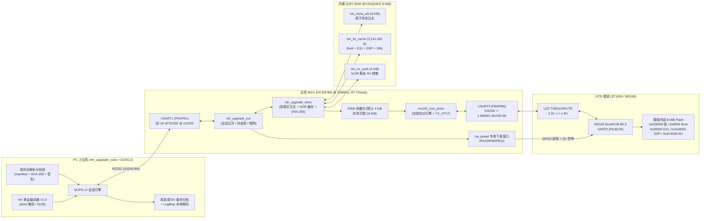
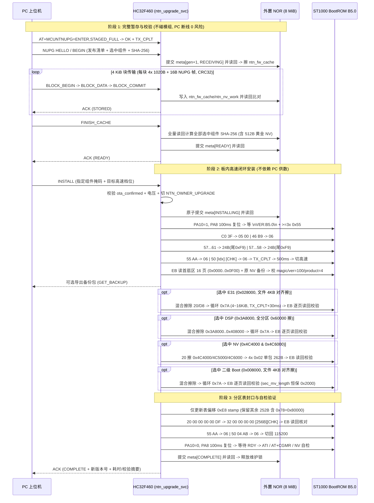

# 铱星 NTN 物联网智能终端——串口升级正式版本实现方案与工程计划 V2.0

| 项目 | 内容 |
| :--- | :--- |
| **文档编号** | YY-NTN-ARCH-202611-S2-003 |
| **完成单位** | youyoutech |
| **责任员工** | 员工3 |
| **发布日期** | 2026-11-28 |
| **适用硬件** | 铱星 NTN 物联网智能终端 V30（主控 `HC32F460` 512 KiB Flash / 192 KiB SRAM，外置 QSPI NOR `BY25Q64ES 8 MiB`，NTN 模组 `ST1000 / MS150`，RS232 `SP3232E`）；显式兼容旧版 2 MiB 硬件 |
| **源码基线** | `hc32f460_rtthread_ntn` 分支 `work_v1_boot_fix @ 03b0abc3f4` |
| **协议基线** | [NTN串口升级_BusHound实测协议冻结规范_员工3_V2.0.md](NTN串口升级_BusHound实测协议冻结规范_员工3_V2.0.md) |
| **核心范围** | **全量四组件正式版升级（二级 Boot、E31、DSP、NV）**，支持独立勾选与发布组合，覆盖 PC 上位机、MCU 固件、外置 NOR 暂存、掉电恢复、产线救援与验收计划 |

---

## 1. 系统总体架构与模式决策

### 1.1 架构选型结论

综合 `step1` 全员评审共识、V30 样板实机 `flash_info` 输出（`BY25Q64ES (SFDP)`, `JEDEC 68 40 17`, `8192 KiB`, `reserved = [0x212000, 0x800000)`）以及 `step2` 四组件 Bus Hound 实测协议冻结结果，正式版本采用 **“一核三模、显式协商、阶段解耦”** 架构：

1. **主模式：`STAGED_FULL`（外置 8 MiB NOR 整包暂存 + MCU 板内高速闭环烧录）—— V30 量产及现场运维标准模式**
   - **收包阶段（不触碰模组）**：PC 通过现有 RS232 (`UART1`, 115200 8N1) 采用 `NUPG` 二进制帧分块上传经校验的四组件镜像及预编译黄金 NV，MCU 落盘至外置 NOR 专用 `ntn_fw_cache` 分区，全包到齐后 MCU 从 NOR **全量读回计算 SHA-256**，通过后原子提交 `READY`。此阶段 PC 掉线或主机复位，**NTN 模组零改动、原业务继续运行**。
   - **安装阶段（摆脱 PC 实时供数依赖）**：收到显式 `INSTALL` 指令后，MCU 原子落盘 `INSTALLING`，独占 `USART3` 与模组电源/GPIO，进入 BootROM，依次完成备份、擦除、`0x7A`/`0x02` 写入、`0xEB` 读回校验与 `0x32` 分区表时间戳封口，最后切回 115200 bps 硬件复位并做 `ATI`/`AT+CGMR`/NV 自检。
2. **兼容模式 1：`STREAM_4K`（PC 实时 4 KiB 分块流式代理）—— 旧版 2 MiB 硬件 / 外置 NOR 故障降级显式模式**
   - 仅当目标板探测 NOR 容量不足 8 MiB 或 NOR 处于故障降级态，且上位机**显式声明** `STREAM_4K` 模式时允许启用（**绝不静默降级**），明确提示操作员全程禁止断开 PC 串口。
3. **工程救援模式：`PASSTHROUGH_115200`（受控串口透明桥接）—— 工厂产测与深度救砖模式**
   - MCU 将 `ST1000` 引导进入 BootROM 并独占桥接 `USART1 ↔ USART3`（双向 115200 bps），供研发/产线直接使用智联安原厂 `MCDTV5.exe`（波特率框必选 `115200`）进行交叉核验或深度救援。

### 1.2 系统全景架构图



---

## 2. 外置 8 MiB NOR Flash 正式分区与存储状态机设计

### 2.1 FAL 分区布局（替换 `reserved`，零重叠、零越界）

对照当前 `boot/ota_layout.h` 与 `board/ports/fal_cfg.h`（实机输出 `BY25Q64ES, 8192 KiB, sector=4096 B`）：
- **`0x000000..0x211FFF` 严禁修改**：包含 MCU OTA `download` (`0x000000..0x05E000`)、`factory` (`0x080000..0x100000`)、`kvdb` (`0x100000..0x140000`)、`store_forward` (`0x140000..0x200000`)、MCU OTA `ota_scratch` (`0x200000..0x210000`) 及 `ota_log_a/b` (`0x210000..0x212000`)。
- **将原单一 `reserved [0x212000, 0x800000)` (`0x5EE000 = 6,217,728 B`) 整体替换为以下 5 个互不重叠的 4 KiB 对齐 FAL 分区**（禁止保留重叠可写的 `reserved` 别名）：

| 分区名 | 起始偏移 | 长度（HEX / 字节） | 结束偏移（不含） | 用途与保护规则 |
| :--- | :---: | :---: | :---: | :--- |
| `ntn_meta_a` | `0x00212000` | `0x00001000` (4 KiB) | `0x00213000` | NTN 升级原子状态与清单元数据日志扇区 A |
| `ntn_meta_b` | `0x00213000` | `0x00001000` (4 KiB) | `0x00214000` | NTN 升级原子状态与清单元数据日志扇区 B |
| `ntn_fw_cache` | `0x00214000` | `0x002FF000` (3,141,632 B) | `0x00513000` | 四组件原始文件暂存区（动态按清单分配 4 KiB 对齐槽） |
| `ntn_nv_work` | `0x00513000` | `0x00001000` (4 KiB) | `0x00514000` | 预编译 512 B 黄金 NV 镜像及安装期 NV 备份工作区 |
| `ntn_spare` | `0x00514000` | `0x002EC000` (3,063,808 B) | `0x00800000` | 后续业务/扩展保留区（升级引擎禁写） |

- **容量余量核算（以 CA034 四组件为例）**：
  - E31 (`2,509,271 B` → 对齐 `2,510,848 B`) + DSP (`74,519 B` → 对齐 `77,824 B`) + 二级 Boot (`122,622 B` → 对齐 `122,880 B`) + NV 原始 XML (`15,841 B` → 对齐 `16,384 B`) = **`2,727,936 B`**；
  - `ntn_fw_cache` 容量 `3,141,632 B`，**尚余 `413,696 B`（404 KiB）** 应对后续版本膨胀；`logmap.json`（~3.12 MiB）仅留 PC 端，严禁入 NOR。
- **非 OTA 构建对齐**：`!defined(NTN_OTA_APP) && !defined(NTN_OTA_BL2)` 分支统一从 `0x212000` 起配置上述 5 分区，保证所有固件构建地址语义唯一。

### 2.2 启动期硬件容量强防护（`app_flash.c` 改造）

在 `app_flash_init()` 调用 `fal_init()` 之后，强制执行运行时容量边界核验：
1. 读取 SFUD 探测的实际 `sfud_dev->chip.capacity`（SFDP）与 `erase_gran`（须为 4096 B）及 JEDEC ID；
2. 遍历已注册的 `ntn_*` 分区，校验 `part->offset + part->len <= sfud_dev->chip.capacity`；
3. 任意校验不通过（如误装 2 MiB 器件或 NOR 探测失败），置位 `s_ntn_stage_storage_ready = RT_FALSE`，`STAGED_FULL` 入口一律返回 `ERR_STORAGE_UNAVAILABLE`，严禁访问 `0x212000` 以上地址。

### 2.3 双扇区追加式原子元数据日志（`ntn_meta_a` / `ntn_meta_b`）

每条元数据记录固定 **256 字节**（每 4 KiB 扇区可追加 16 条，双扇区轮转擦写极大降低磨损）：

```c
#pragma pack(push, 1)
typedef struct {
    uint32_t offset;           /* 在 ntn_fw_cache 内的相对偏移 (4 KiB 对齐) */
    uint32_t length;           /* 文件真实字节长度 (非对齐) */
    uint8_t  sha256[32];       /* 文件真实 SHA-256 */
    uint8_t  selected;         /* 1=本次安装选中, 0=未选 */
    uint8_t  installed;        /* 1=已写入且读回校验通过 */
    uint8_t  rsvd[2];
} ntn_stage_comp_t;            /* 44 B × 4 = 176 B */

typedef struct {
    uint32_t magic;            /* 0x4E544E32 ("NTN2") */
    uint16_t schema_ver;       /* 1 */
    uint16_t state;            /* EMPTY=0, RECEIVING=1, READY=2, INSTALLING=3, VERIFYING=4, COMPLETE=5, RECOV_REQ=6 */
    uint32_t generation;       /* 单调递增代次号 */
    uint32_t profile_flags;    /* bit0:E31 bit1:DSP bit2:NV bit3:BOOT bit4:DSP_FULL_ERASE */
    uint32_t target_baud;      /* 本次安装高速档位 (如 1500000 / 921600 / 460800) */
    uint32_t nv_bin_len;       /* ntn_nv_work 中 512B 黄金镜像长度 (512) */
    uint8_t  nv_bin_sha256[8]; /* 512B 黄金镜像 SHA-256 前 8 字节快速索引 (全 32B 存 comp[NV]) */
    ntn_stage_comp_t comp[4];  /* [0]=E31, [1]=DSP, [2]=NV(XML), [3]=SEC_BOOT (176 B) */
    uint8_t  manifest_sha8[8]; /* 发布清单 SHA-256 前 8B */
    uint32_t last_error;       /* 最近错误码 */
    uint8_t  rsvd[24];         /* 补齐至 248 B */
    uint32_t record_crc32;     /* CRC32(offset 0..247) */
    uint32_t commit_word;      /* 两阶段提交字: 先写 0..251 并读回, 再写 0xA55A5AA5 并读回 */
} ntn_meta_record_t;           /* 精确 256 字节 */
#pragma pack(pop)
```

**原子性顺序铁律**：
1. **接收新包前**：先向新槽位提交 `generation+1, state=RECEIVING` 并读回确认，再擦除 `ntn_fw_cache`——绝不让旧 `READY` 指向被擦除/覆盖的数据。
2. **提交 `READY` 前**：MCU 必须从 `ntn_fw_cache` / `ntn_nv_work` 全量读回计算所有选中组件的 SHA-256 与清单核对无误，才提交 `READY`。
3. **首次擦除模组前**：先提交 `state=INSTALLING` 并读回确认，随后才允许向 MS150 发送任何 `0x20`/`0xD8` 擦除指令。
4. **双扇区轮转**：当前扇区写满 16 条时，先擦除另一扇区、将最新有效记录写入新扇区并读回校验通过后，再擦除旧扇区，确保任意时刻至少一份有效元数据存活。

---

## 3. MCU 固件（`work_v1_boot_fix @ 03b0abc3f4`）精准改造设计

### 3.1 资源预算评估（基于当前 `rtthread.map` 与 `ota_app.sct` 实测数据）

| 资源项 | 硬件/分区上限 | 当前基线已用 | 正式版升级功能新增预算 | 改造后余量 |
| :--- | :---: | :---: | :---: | :---: |
| **片内 Flash (`NTN_OTA_APP_MAX`)** | 365.00 KiB (`0x5B400`) | 232.25 KiB (`237,828 B`) | ~18–24 KiB（协议/存储/状态机/SHA-256） | **≥ 108 KiB**（充裕） |
| **片内 SRAM (`RW_IRAM2 + IRAMB`)** | 191.98 KiB | 70.73 KiB (`72,424 B`) | 10–14 KiB（4 KiB 块模式）或 22–26 KiB（16 KiB 加速模式） | **≥ 95 KiB**（充裕） |

### 3.2 现存源码必须修正的 6 处关键耦合点

| 序号 | 目标源码文件 | 现存隐患（实查源码确认） | 正式版改造方案 |
| :---: | :--- | :--- | :--- |
| **1** | `applications/hw_power.c/.h` | ① `INIT_PREV_EXPORT(hw_power_init)`（初始化级别 2）**早于** `INIT_DEVICE_EXPORT(app_flash_init)`（级别 3），且第 86 行直接调用 `hw_power_ntn_set(RT_TRUE)` 上电模组——掉电重启时会在读到 `INSTALLING` 标志前就误将半刷模组以正常模式启动！<br>② `hw_power_ntn_set(RT_TRUE)` 第 104/112 行强制把 `PA10` 拉低清 BOOT | ① `hw_power_init()` 仅完成 GPIO 安全初始态（`PA8=HIGH` 保持复位、`PB15=LOW` 核心断电、`PA10=LOW`），**将首次 NTN 上电移至 `app_flash_init()` 之后**的 `ntn_boot_policy_init()`（`INIT_COMPONENT_EXPORT`）：先读 `ntn_meta_a/b`，若为 `INSTALLING`/`RECOV_REQ` 则直接调用 `hw_ntn_enter_download()`，否则正常 `hw_power_ntn_set(RT_TRUE)`。<br>② 新增专用接口 `hw_ntn_enter_download()`（`PA10=1` → 10ms → `PA8=1` 100ms → `PA8=0`）、`hw_ntn_exit_download()`（`PA10=0` → 10ms → `PA8` 100ms 脉冲）与 `hw_ntn_hard_power_cycle(boot_mode)`（断 `PB15`/`PB0` 1s 冷重启救砖）；升级态下普通 `hw_power_ntn_set()` 返回 `-RT_EBUSY`。 |
| **2** | `applications/ntn_ms150.c/.h` | 当前 `ntn_rx_thread_entry` 将所有 UART3 字节送入 AT/URC 解析；`ntn_service` 自动巡检、定位与建链会竞争串口 | 引入唯一所有权状态 `NTN_OWNER_NORMAL / NTN_OWNER_UPGRADE / NTN_OWNER_RECOVERY`：切换前先等在途 AT 事务完成（超时则返回失败），切换后 **唯一 `ntn_rx_thread` 在入口即按所有权将原始字节直投升级环形缓冲**（零竞争、不新建第二个 UART3 读线程）；同时暂停 `ntn_service` 业务动作但保持 `task_wdt_heartbeat_by_name("ntn")` 心跳。 |
| **3** | `board/drv_usart.c` / 串口适配层 | 当前 `hc32_putc` 仅判 `USART_FLAG_TX_EMPTY` 而非移位寄存器发完 `USART_FLAG_TX_CPLT`；`rxerr` 中断静默清 ORE/FE 标志；未开 UART3 DMA | ① 提供 `bsp_uart3_wait_tx_cplt(timeout_ms)` 轮询 `USART_FLAG_TX_CPLT`（带超时防死等），在发完 `0x7A` 9B 头后（启动 30ms 计时前）、发完 `0x50` 切速指令后、以及切回正常复位前强制调用。<br>② 暴露 UART3 `ore_cnt / fe_cnt / pe_cnt` 硬件错误计数器，单块接收期间若任一错误计数递增，立即判定本帧无效并触发重同步/重试。<br>③ 按 M0 实测评估开启 `BSP_UART3_RX_USING_DMA`（显著降低 1.5M 下 `0xEB` 256B 读回时的中断压力）。 |
| **4** | `applications/mcu_local_cmd.c` & `applications/main.c` | ① `AT+MCUUPG` 已固定用于主 MCU OTA（`PC_FULL/YMODEM`），不可改义；<br>② **`main.c` 第 71–78 行**：MCU OTA 试运行未确认前 60s 将触发 `rt_hw_cpu_reset()`，若此时正在刷 MS150 会强行腰斩！ | ① 新增独立命令族：`AT+MCUNTNUPG?`（能力、NOR 状态、支持模式、当前缓存/恢复态）、`AT+MCUNTNUPG=ENTER,<mode>`（切换二进制维护会话，先回完整 `OK` 并等 `USART1` `TX_CPLT` 再切态）、`AT+MCUNTNUPG=STATUS`、`AT+MCUNTNUPG=RECOVERY`。<br>② **强制前置门禁**：若 `NTN_OTA_APP` 定义且 `!ntn_ota_is_confirmed()`，或主 MCU OTA 正在进行，或电源欠压（`!ntn_ota_voltage_ok()`），一律拒绝进入 NTN 升级并返回明确错误码；同理，NTN 升级进行中拒绝 `AT+MCUOTA=BOOT`。 |
| **5** | `applications/pc_rs232.c` & `applications/app_telemetry.c` & `applications/ble_uart.c` | `pc_rs232` 默认按 20ms 字节间空闲拆帧交 `pc_maint_core` / RAW 上行路由；BLE 侧可并发下发 AT | 进入 `NUPG` 二进制会话后，绕过 `pc_maint_core` 的 `+++` 与 AT 行解析（避免镜像中含 `00/CR/LF/AT/+++` 误触发），将 `USART1` 原始字节流直投 `NUPG` 定长帧状态机；同时暂停外部 RAW 上行入队（保留原有未发队列不清零），BLE 侧 NTN 请求返回 `BUSY`。 |
| **6** | `applications/task_wdt.c` & `boot/ota_icg.h` | `task_wdt` 监控 `rs232/ntn/ble/gnss` 线程，同时 BL1 硬件 `SWDT` 周期约 26.21s（最小 23.83s） | 升级线程独立注册 `task_wdt`，在擦除/块写/NOR 读写/SHA-256 循环内每 ≤500ms 喂心跳；`rs232`/`ntn` 线程处于维护态时不阻塞死等，持续按 ≤2s 节奏喂狗，保障 `task_wdt` 1 Hz 守护线程持续刷新 `SWDT` 与 `WDT`。 |

### 3.3 新增 3 个高内聚 MCU 模块划分

| 模块文件 | 职责边界 | 可测试性设计 |
| :--- | :--- | :--- |
| `applications/ms150_rom_proto.c/.h` | 封装冻结版 MS150 BootROM 协议：`sync_u_and_c0`、`qspi_init_46`、`clear_wp_57`（24B+`0xF9` 严检）、`set_baud_50`（`55 AA`+`50 xx`+`TX_CPLT`+延时）、`erase_mixed`（`20`/`D8`）、`write_block_7a`（9B 头→`TX_CPLT`→30ms→载荷+CHK→`0x06`）、`write_page_02`（262B 单包）、`read_page_eb`（纯 256B）、`write_table_32`（262B 单包） | 纯状态机 + 抽象串口回调 `ops(tx/rx/wait_tx_cplt/set_baud/delay_ms)`，**可在 PC 端用 `step2` 4 份抓包构造 Mock 桩做 100% 离线单元测试** |
| `applications/ntn_upgrade_store.c/.h` | 封装外置 NOR 5 分区管理：启动容量/JEDEC/SFDP 检查、双扇区 `ntn_meta_a/b` 追加与两阶段提交、4 KiB 块落盘与读回、整包流式 SHA-256 校验（复用工程已有 mbedTLS/TinyCrypt SHA-256 或轻量实现） | 可在主机模拟器上注入掉电点（写记录中断、写提交字中断、扇区轮转中断）做压力测试 |
| `applications/ntn_upgrade_svc.c/.h` | 封装 `NUPG` 二进制帧收发、幂等重传缓存、会话状态机（`IDLE → RECEIVING → READY → INSTALLING → VERIFYING → COMPLETE / RECOVERY_REQUIRED`）、四组件安全烧录编排、开机早期掉电恢复入口及 `PASSTHROUGH_115200` 救援桥接 | 与 `mcu_local_cmd.c`、`ntn_ms150.c`、`hw_power.c` 清晰解耦 |

---

## 4. 四组件烧录编排、分块粒度优化与耗时预算

### 4.1 四组件完整安装原子流水线（基于实测冻结协议）



### 4.2 关键工程洞察：块大小（4 KiB vs 16 KiB）与端到端真实耗时测算

以 CA034 完整四组件为例（有效写入载荷：E31 `2,509,271 B` + DSP `74,519 B` + Boot `122,622 B` + NV `1,024 B` = **`2,707,436 B`**；PC 传给 MCU 的四组件原始总长 = **`2,722,253 B`** + 512B 黄金 NV）：

| 阶段 | 物理链路与参数 | 理论下限 | 工程实测预期耗时 | 关键瓶颈与优化手段 |
| :--- | :--- | :---: | :---: | :--- |
| **阶段 1：PC → MCU NOR 暂存** | RS232 `115200 8N1` (`11,520 B/s`), `NUPG` 1020B 帧 + NOR 写/读回 + SHA-256 | 236.3 s（纯载荷） | **265 ~ 295 s**（约 4.5 ~ 4.9 分钟） | 受 `SP3232E` 物理上限制约；若短线实测 `230400 bps` 误码率为 0，可作为产线可选高速档将本阶段缩短至 **~140 ~ 160 s** |
| **阶段 2A：板内烧录（1.5 Mbps, `0x7A` 4 KiB 块）** | 662 块 × 30 ms 握手 (`19.9 s`) + 写载荷 (`18.1 s`) + `0xEB` 读回 (`18.1 s`) + 擦除/编程 (`~12 s`) | 68 s | **70 ~ 85 s**（约 1.2 ~ 1.4 分钟） | 仅需 4 KiB 块缓冲；**推荐作为 M2 首版稳妥基线** |
| **阶段 2B：板内烧录（1.5 Mbps, `0x7A` 16 KiB 块优化）** | 166 块 × 30 ms 握手 (`5.0 s`) + 写载荷 (`18.1 s`) + `0xEB` 读回 (`18.1 s`) + 擦除/编程 (`~10 s`) | 51 s | **55 ~ 68 s**（约 1 分钟） | 仅多占 12 KiB SRAM（余量仍 >95 KiB），直接削减 **15 秒** 30ms 等待开销；M3 验证通过后可作为默认配置 |
| **阶段 2C：降档对比（921.6K / 460.8K, 16 KiB 块）** | 写入 + 读回随波特率线性缩放 | 74 s / 133 s | **80 ~ 95 s** / **140 ~ 160 s** | 若 M0 波形表明 `U22 (TXB0104)` 在 1.5M 裕量不足，优先定档 `921600` 或 `460800 bps` |
| **阶段 3：重启与版本自检** | 复位 + Boot + `RDY` + `ATI`/`AT+CGMR` | ~3 s | **5 ~ 10 s** | 独立报告自检结果，不与卫星入网强绑定 |
| **整机端到端总计（115200 PC + 1.5M 板内）** | 完整四组件含全量读回校验 | ~300 s | **约 5.5 ~ 6.3 分钟** | 诚实告知产品/测试：外置 NOR 暂存的核心价值是**阶段解耦、零掉线变砖与断点恢复**，而非突破 RS232 115200 物理速率 |

---

## 5. PC 上位机正式版方案与发布包规范

### 5.1 软件形态与分层设计
- **形态选择**：采用 **独立桌面工具（Python/PySide6 或 C# .NET 桌面程序）+ 无界面 CLI 核心引擎 `ntn_upgrader_cli`**（CLI 直接服务自动化产测脚本与回归测试；不依赖浏览器 Web Serial 以避免长时串口权限回收、USB 缓冲抖动与后台页签节流）。
- **核心功能模块**：
  1. **发布包构建与验签工具 (`pack_ntn_release.py`)**：
     - 强制把同一版本的 E31、DSP、二级 Boot、NV XML、`logmap.json` 打包为受控目录/容器，生成 `release_manifest.json`（含机型 `ST1000`、目标分区表 profile `sharkNTN_v100_p4`、版本 ID、全部组件 SHA-256 与大小、预编译 512B 黄金 NV 镜像及双 SHA-256、Ed25519 发布签名预留字段）。
     - **强制防呆**：禁止混选不同发布版本（如 CA033 与 CA034）；`logmap.json` 自动剥离仅留存 PC 诊断目录，绝不进入下发队列。
  2. **NV 设备专属参数保护策略**：
     - 升级 NV 前先通过 `GET_BACKUP` 读回并归档模组当前 `0x4C4000` 与 `0x4C6000` 原始 512B 镜像；
     - 正式版默认提供两种策略：① `FACTORY_RESET_NV`（使用发布包预编译黄金 512B 覆盖，适用产线/重大版本迁移）；② `PRESERVE_FIELD_NV`（后续按厂商确认的现场专属字段清单如频段/APN/校准偏移，从备份合并后重算 `PageCRC` 再下发）。默认未显式勾选 NV 时保持原 NV 不动。
  3. **会话与恢复引擎 (`NUPG v1`)**：
     - 沿用跨员工共识的 22B 固定开销二进制帧（`magic="NUPG"`, `ver=1`, `type`, `flags`, `session_id`, `seq`, `payload_len<=1020`, `payload`, `crc32/ISO-HDLC`）；
     - 单请求在途 + 幂等重传（同 `session_id + seq + 内容` 返回缓存结果，不同内容报 `ERR_SEQ_CONFLICT`）；
     - 界面严格区分四段真实进度：`① PC→NOR 暂存进度` / `② NOR 全量 SHA-256 校验` / `③ MS150 分组件擦写+读回校验` / `④ 冷启动版本自检`，严禁把“PC 发送完成”伪装成“模组升级成功”。
  4. **诊断与追溯归档**：每次升级自动生成本地审计包（`device_sn`、升级前后 `ATI`/`AT+CGMR`、原首扇区 4 KiB 完整备份、原 NV 备份、`manifest_sha256`、逐阶段耗时与错误计数）。

---

## 6. 掉电防变砖、异常恢复与安全边界

| 异常场景 | 持久状态与检测方式 | 正式版确定性恢复动作 | 安全边界说明 |
| :--- | :--- | :--- | :--- |
| **PC 传包中断 / MCU 掉电（`RECEIVING`）** | `ntn_meta` 最高有效代次为 `RECEIVING` | 模组零改动，正常业务照常启动；PC 重连查询状态后支持从首个未校验 4 KiB 块续传或重新传包 | **100% 无损** |
| **NOR 缓存校验不通过 / 硬件故障** | SHA-256 不匹配或 SFUD I/O 失败 | 拒绝进入 `INSTALLING`，绝不拉 `BOOTSEL` 或擦除模组；明确上报存储故障码 | 若需继续升级，须人工显式切换 `STREAM_4K` |
| **安装中途 PC 拔线（`INSTALLING`）** | 缓存已 `READY` 且不依赖 PC 供数 | MCU 依靠已校验的 `ntn_fw_cache` **自主完成剩余全部烧录、封口与自检**并记录 `COMPLETE`；PC 重连查询即可取回结果 | 首次开发验收期建议保持 PC 连线记录诊断日志 |
| **安装中途整机断电 / MCU 复位（`INSTALLING`）** | 下次开机 `ntn_boot_policy_init()` 早于正常上电检出 `INSTALLING` | **抑制正常 AT/业务启动** → 直接拉 `PA10=1` 进 BootROM → 重新全量核验 NOR 缓存 SHA-256 → 对未标 `installed=1` 的组件执行完整重刷与校验 → 封口启动 → 置 `COMPLETE` | 若缓存本身损坏无法通过 SHA-256，则停在 `RECOVERY_REQUIRED`（保持下载态等待 PC 重新供包） |
| **`0x7A`/`0x20`/`0xD8` ACK 丢失或 UART 溢出** | 超时或 `ore/fe/pe_cnt > 0` | 立即停止续发 → 尝试重同步或 `hw_ntn_hard_power_cycle(BOOT)` 硬重启重入 ROM → `0xEB` 读回当前扇区判定是否已写齐 → 未齐则整扇区重擦重写（最多 3 次） | 严禁在 Flash 未重擦的情况下叠写重试 |
| **首扇区 `0x00000000` 擦写瞬间掉电** | 极短非原子窗口（约 50 ms） | 重启后 `0xEB` 读 `0x00000000` 检出魔数失效 → 利用 `ntn_nv_work`/PC 备份的原始 256B 表头重建并重刷（硬件 `BOOTSEL` 仍可直接进 BootROM） | **诚实声明**：MS150 单分区表架构无硬件 A/B 自动回滚；依赖 ROM 永可进入 + 完整备份闭环兜底 |

---

## 7. 正式版本工程实施计划（4 周 / 5 里程碑）

### 7.1 里程碑排期总览


### 7.2 分阶段 WBS 任务清单、责任分工与准出条件（Exit Criteria）

| 里程碑 | 时间 | 核心任务分解（WBS） | 责任角色 | 交付物 | 强制准出条件（Exit Criteria） |
| :---: | :---: | :--- | :---: | :--- | :--- |
| **M0**<br>硬件与物理波形终验 | Day 1–3 | 1. 归档 V30 样板 `BY25Q64ES` BOM/PCBA 版本与实物照片（彻底闭合 B02 追溯）。<br>2. 在 V30 实板 `U22 (TXB0104)` 两侧挂示波器 + ≥50MHz 逻辑分析仪，实测 `1.5M / 921.6K / 460.8K / 115.2K` 眼图与误码率（关闭 B08）。<br>3. 实测 `50 09 A6` ACK 物理速率归属、`0x7A` 4 KiB/16 KiB 块写头后 30ms 物理间隔、以及 115200 低速烧录可行性（关闭 B05 物理层）。<br>4. 冻结 `NUPG v1` 与 `release_manifest.json` 接口规范。 | 硬件 + 测试 + 协议（员工 3/1/2 协同） | 《V30 波形与波特率定档报告》、逻辑分析仪原始工程、`NUPG_v1_Spec` | 确定板内生产默认高速档（1.5M 或 921.6K）与回退档；确认 4 KiB/16 KiB `0x7A` 写入 100% 通过且无误码 |
| **M1**<br>MCU 底层底座改造 | Day 4–8 | 1. 修改 `boot/ota_layout.h`、`board/ports/fal_cfg.h`，替换 `reserved` 为 5 个互不重叠分区；升级 `app_flash.c` 启动 SFDP 容量/边界校验（关闭 B03）。<br>2. 改造 `hw_power.c` 初始化顺序（延后首次 NTN 上电至 NOR 读检后）并实现 `hw_ntn_enter_download` / `exit_download` / `hard_power_cycle`。<br>3. 完善 `drv_usart.c` `USART_FLAG_TX_CPLT` 排空与 RX 错误计数（按 M0 结果决定是否开 UART3 DMA）。<br>4. 实现 `ntn_upgrade_store.c/.h`（双扇区原子日志 + NOR 缓存 + SHA-256）及主机单元测试。<br>5. 改造 `ntn_ms150.c` 唯一读者所有权与 `mcu_local_cmd.c`（含 `ntn_ota_is_confirmed()` 互斥门禁）。 | MCU 研发 | 可编译运行的 `ntn-ota-app` 分支代码 + 单元测试报告 | `flash_info` 正确显示 5 个新分区；2 MiB 模拟边界拒绝生效；MCU OTA 与 NTN 升级互斥测试 PASS；开机日志验证 `INSTALLING` 标志能阻断正常上电 |
| **M2**<br>协议引擎与 PC CLI 联调 | Day 9–13 | 1. 实现 `ms150_rom_proto.c/.h` 并以 `step2` 4 份抓包为黄金向量做 100% 离线 Mock 单元测试。<br>2. 实现 `ntn_upgrade_svc.c/.h`（`STAGED_FULL` + `STREAM_4K` + `PASSTHROUGH_115200` + `task_wdt`/`SWDT` 喂狗）。<br>3. 实现 PC 端 `pack_ntn_release.py`（集成 `compile_nv_xml_v2.py` 黄金编译器）与 `ntn_upgrader_cli`。<br>4. 实板打通只读握手/备份 → E31+DSP 组合升级闭环。 | MCU + PC 研发 | MCU 完整升级固件、`ntn_upgrader_cli`、实板联调日志 | 实板连续 3 轮 CA033 ↔ CA034（E31+DSP）升级 100% 通过，`ATI`/`AT+CGMR` 匹配，`0x78=0x80000` 未被破坏，看门狗 0 误复位 |
| **M3**<br>四组件全量与掉电恢复压测 | Day 14–17 | 1. 开放并实板验证 **二级 Boot (`0x8000`)** 与 **NV (`0x4C4000/0x4C6000`)** 全量四组件升级（验证黄金 512B 读回 0 差异与现场配置自检）。<br>2. 实施 **6 类破坏性故障注入**：收包拔线、安装拔线、E31 写 50% 整机断电、二级 Boot 写 50% 整机断电、表提交前断电、CRC 篡改/跨版本混包注入。<br>3. 开展 20 轮连续高低温/常规循环稳定性压测（含 16 KiB 块写加速验证）及内存/栈高水位与 Flash 业务队列完整性检查。 | 测试 + MCU + PC | 《系统验收测试报告》、20 轮压测统计、掉电恢复录像/日志 | 四组件单选与全选 100% PASS；6 类故障注入全部闭环恢复且 0 变砖；20 轮连续升级成功率 **100% (20/20)**；MCU 原有 `kvdb`/`store_forward`/OTA 分区字节 0 改动 |
| **M4**<br>正式 GUI 与量产放行 | Day 18–20 | 1. 封装 PC 正式桌面 GUI（绑定 `ntn_upgrader_cli` 核心库，含自动备份归档、防呆版本选择与四段进度条）。<br>2. 输出《产线烧录与应急救援 SOP》（含 `PASSTHROUGH_115200` + `MCDTV5.exe` 操作规程）与《现场运维升级手册》。<br>3. 代码评审合并主线，执行 `release_all.ps1` 整机签发归档。 | PC + 硬件 + QA + 产品 | 正式安装包（带 SHA-256）、产线 SOP、放行评审单 | 通过跨部门量产放行评审（硬件/MCU/PC/测试四方签字） |

---

## 8. 正式版本系统验收测试用例矩阵

| 用例编号 | 类别 | 测试内容与注入条件 | 严格通过判据 | 对应阶段 |
| :---: | :--- | :--- | :--- | :---: |
| **VT-01** | 硬件物理层 | 示波器/逻辑分析仪测 `PA10/PA8/PB15` 极性及 `U22` 两侧 `1.5M/921.6K/460.8K` 眼图 | 反相电平正确；选定高速档连续 10 轮收发 0 帧错/0 溢出 | M0 |
| **VT-02** | 存储与互斥 | 验证 5 个新 FAL 分区边界、伪造 2 MiB 容量拒绝、未确认 MCU OTA 拒入、BLE/RAW 并发 | 非法容量拒入 `STAGED_FULL`；`0x200000..0x211FFF` 0 改动；并发入口全回 `BUSY` | M1 |
| **VT-03** | 协议黄金向量 | 离线 Mock 对 `ms150_rom_proto` 回放 `0xC0/0x46/0x57(24B+0xF9)/0x55/0x50/0x20/0xD8/0x7A/0x02/0xEB/0x32` | 所有帧 XOR、24B 严检、纯 256B 读回与异常重同步 100% PASS | M2 |
| **VT-04** | 分区表红线 | 检查升级前后 `0x00000000` 全 256B 差异 | 仅 `0xE8` `stamp` 更新；`magic1/2`、`sec_mv_length=0x2000`、`rfe_nv=0x0713C398`、`firmware.mv_length=0x80000`、`dsp0=0` 逐位不变 | M2/M3 |
| **VT-05** | NV 黄金实刷 | 使用 `compile_nv_xml_v2.py` 编译 CA034 XML 刷入主备双区并读回 | `0x4C4000..0x4C41FF` 与 `0x4C6000..0x4C61FF` 读回 SHA-256 精确等于 `bd2b65dc...6c7eab5`；开机 AT 读参正常 | M3 |
| **VT-06** | 四组件全量 | CA033 → CA034 四组件（E31+DSP+NV+Boot）全选及逐项单选升级 | 全部组件写后 `0xEB` 读回 0 差异；冷启动 `ATI`/`AT+CGMR` 符合目标版本；原有业务与卫星链路自检正常 | M3 |
| **VT-07** | 防错防混包 | 投喂 CA033/CA034 混包、篡改 1 字节的 BIN、将 `logmap.json` 塞入包、含 `00/CR/LF/AT/+++` 载荷 | 混包与篡改包在 `READY` 前被 100% 拦截且不碰模组；特殊字节流 100% 透传不误触发 AT | M2/M3 |
| **VT-08** | 收包断线恢复 | `STAGED_FULL` 收包至 40% 时拔掉 RS232 线 / 断电 | 模组原固件正常运行；重连后可从断点续传或重传，半包永不标 `READY` | M3 |
| **VT-09** | 安装断电救砖 | `STAGED_FULL` 写入 E31 50% 与二级 Boot 50% 时拔掉整机供电 | 重新上电后 MCU 早期识别 `INSTALLING`，抑制正常业务，校验 NOR 缓存后自主重入 ROM 完成重刷并自检通过 | M3 |
| **VT-10** | 降级与救援 | ① 模拟 NOR 故障显式启用 `STREAM_4K` 完成升级；② 启用 `PASSTHROUGH_115200` 接原厂 `MCDTV5.exe` 选 115200 刷机 | 两种模式均实板全流程通过，且 `STAGED_FULL` 绝不静默降级为 `STREAM_4K` | M3/M4 |
| **VT-11** | 长稳与资源 | 连续 20 轮完整四组件循环升级，统计耗时、堆峰值、各线程栈高水位与 WDT 计数 | 20/20 PASS；0 看门狗误复位；0 内存泄漏；原有 `store_forward` 缓存数据 100% 完好 | M3 |

---

## 9. 风险台账与缓解预案

| 风险等级 | 风险描述 | 触发征兆 | 预案与缓解措施 |
| :---: | :--- | :--- | :--- |
| **高** | `HC32F460` 内部 16 MHz HRC 温漂叠加 `TXB0104RUTR` 分布电容导致板内 1.5 Mbps 在高低温下出现误码 | M0 眼图振铃或 `fe_cnt/ore_cnt > 0` | M0 实测验证 `1.5M / 921.6K / 460.8K` 三档并建立温箱裕量；协议支持**单次安装自适应降档重试**（`1.5M → 921.6K → 460.8K`），牺牲约 20–60 秒换取 100% 零误码 |
| **高** | 未来版本 NV XML 新增字段或超 512 B、或某 `U32` 字段真需要 `> 0x7FFFFFFF` | 编译器告警 `U32 clamped` 或总长 `> 512 B` | `compile_nv_xml_v2.py` 强制打印 `strtol` 截断告警并拒绝 `> 512 B`；每次大版本升级 NV XML 必须先用原厂 MCDT 抓一次 18 KB 的短 `nv下载.txt` 复验黄金向量 |
| **中** | `0x00000000` 首扇区擦写瞬间（~50 ms）整机断电 | 下次读 `0x00000000` 魔数无效 | 开机早期在 `ntn_nv_work` 留存一份经过校验的本机首扇区 256B 原始快照（擦首扇区前持久化），断电重启后可直接由快照重建表头；同时 PC 端保留完整 4 KiB 备份 |
| **中** | 现场设备存在旧版 2 MiB NOR 硬件混用 | 启动 SFDP 探测容量为 2048 KiB | `app_flash_init()` 运行时自动禁用 `ntn_*` 分区并向 PC 上报 `nor_mib=2`，上位机界面自动引导进入显式 `STREAM_4K` 维护流程 |
| **低** | RS232 115200 bps 传输 2.7 MiB 耗时约 4.5 分钟引起用户误判卡死 | 现场运维提前拔线 | PC GUI 实时展示逐块速率、剩余时间与阶段状态；`STAGED_FULL` 阶段 1 即使误拔线也不损伤模组且支持续传 |
